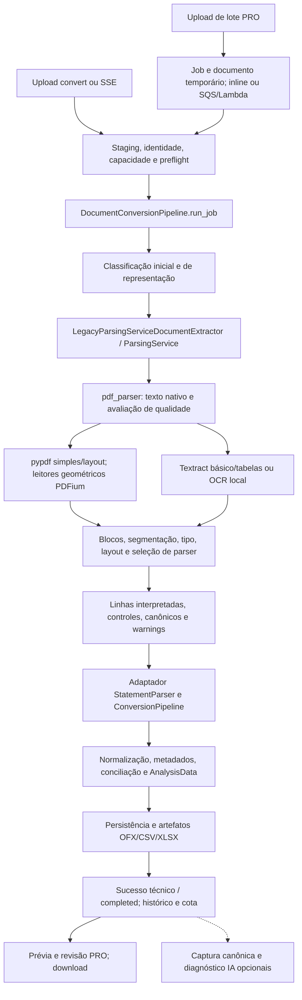

# OFX-47 — Confiabilidade e arquitetura do conversor

Data: 29/10/2026 (America/Sao_Paulo). Base examinada: `5f30fdfb40d6507b5597286b8bd63d0fcea22898`, atualizada de `origin/main`. Escopo: [OFX-47, Fase 1](https://linear.app/ofxsimples/issue/OFX-47). Este relatório é o único artefato versionado desta entrega. Não implementa POC, altera regras nem ativa serviços.

## 1. Decisão recomendada

**O conversor detecta várias inconsistências, mas ainda não demonstra que reconhece todos os seus erros.** Há controles úteis por layout, revisão de saldos, detecção de páginas potencialmente ausentes, tratamento de blocos e proveniência. Entretanto, parte da validação usa os valores já interpretados pelo próprio parser; algumas heurísticas modificam esses valores a partir de saldos; e os estados de qualidade, recomendação de exportação e apresentação no PRO não usam o mesmo contrato.

A recomendação é começar por **A: verificação independente em modo sombra**, acompanhada de uma extensão pequena dos contratos de evidência já existentes, o primeiro passo de **B**. Só depois de medir erros e falsos alertas no mesmo benchmark, avaliar **C: recuperação seletiva**. Uma reescrita geral de `pdf_parser.py` ou dos YAMLs não está justificada pelos dados disponíveis.

Prioridades de risco demonstradas nesta execução:

1. **Valor reconstruído pode confirmar a própria reconstrução.** Um diagnóstico fictício produziu valor `100` a partir do token `1.100,00` e saldo anterior `1000`; o saldo inferido `1100` passou na validação posterior, sem warning. Isso demonstra a dependência entre inferência e verificação, não a frequência desse erro em arquivos de clientes.
2. **Ano pode ser preenchido pelo relógio.** Um PDF fictício sem ano gerou datas de 2026 no caminho público. A política compartilhada deve distinguir período opcional de contexto obrigatório da data.
3. **Linhas e páginas podem perder identidade.** Uma data inválida desapareceu da lista de movimentos, restando apenas contador; uma primeira página vazia deslocou a origem dos movimentos da página física 2 para `source_page=1`.
4. **“Mais linhas” pode vencer evidência financeira pior.** `_is_better_parse_result` aceitou quatro transações com nove falhas de saldo contra duas sem falhas, pela primeira condição da função.
5. **“Clean” não significa exatidão auditada.** A classificação histórica aceita layout conhecido e ausência de alertas; ignora `parser_coverage_rate`. A captura canônica exclui `clean`, e não foi encontrado um manifesto de sucessos reais com ground truth independente.

Os itens acima são fatos de código ou diagnósticos reproduzidos, com limites descritos abaixo. **Não foi medida taxa de erro silencioso em produção**, nem confirmada uma quantidade de PDFs reais incorretamente entregues. Os testes passaram; isso demonstra estabilidade nos casos existentes, não acurácia na distribuição de documentos reais.

## 2. Método, evidência e limites

Foram lidos os entrypoints, orquestradores, seleção e caminhos principais de extração, normalização, saldos, blocos, modelos de evidência, exportação, telemetria, captura canônica, recuperação por IA, adaptação PRO, perfis representativos e testes. A leitura foi dirigida: não é uma certificação individual de cada parser específico.

As evidências usam três níveis:

- **Fato:** comportamento diretamente identificado em arquivo/símbolo.
- **Reprodução:** execução do código existente com valores fictícios, em memória, sem novo teste ou fixture versionada. As reproduções de helpers não equivalem a reproduções HTTP nem a incidência em produção.
- **Hipótese:** falha plausível cujo alcance depende de corpus real independente. Deve virar caso de benchmark antes de mudar a aceitação.

Não foram consultados banco de produção, buckets, PDFs privados, credenciais ou variáveis secretas. Não houve nova chamada paga de OCR/IA nem cópia de documento real. O Linear forneceu a descrição e nenhum comentário; a consulta às notas compartilhadas retornou `Tool get_agent_context not found`. Assim, não se atribui evidência a notas indisponíveis. Defaults de código não são prova da configuração implantada.

Inventário reproduzido por leitura/AST/importação local:

| Item | Contagem nesta base | Interpretação |
| --- | ---: | --- |
| `application/pdf_parser.py` | 4.535 linhas; 134 funções de topo | Ainda concentra extração, roteamento, recuperação, parsing e construção de métricas. O nome real é `pdf_parser.py`. |
| `layout_profiles/profiles/*.yaml` | 142 arquivos; 141 perfis carregados | Um template é excluído pelo registro. Não equivale a 141 layouts validados em PDFs reais. |
| `parsers/pdf/layout_specific/*.py` | 42 arquivos | Inclui contratos, registro e helpers. |
| `DEFAULT_PDF_LAYOUT_PARSER_REGISTRY` | 32 parsers; 79 nomes de layout | Há caminhos especializados fora desse registro. |
| `backend/tests/test_*.py` | 353 arquivos | Contagem de arquivos, não documentos independentes. |
| Golden mínimo | 22 cenários; 21 expectativas de sucesso e 1 erro | Muitos substituem extração e inferência; não são 22 PDFs reais auditados. |
| Corpus sintético modular | 5 cenários, variantes texto/scan | 3 obrigatórios e 2 lacunas conhecidas não bloqueantes no catálogo. |
| PDFs rastreados pelo Git | 0 | Não implica ausência de arquivos privados fora do versionamento. Eles não foram enumerados nem usados. |

Todos os caminhos abaixo são relativos à raiz do repositório; os símbolos e a revisão acima fixam a referência, inclusive quando linhas mudarem depois deste PR.

## 3. Fluxo AS-IS e responsabilidades



O desenho mostra as dependências principais; os retornos antecipados de leitores especializados impedem interpretar cada caixa como uma etapa uniforme para todos os PDFs.

| Etapa | Arquivo e símbolo | Comportamento / implicação |
| --- | --- | --- |
| Entrada pública | `backend/app/routers/upload.py`: `convert`, `conversion_upload_stream`, `_handle_conversion_upload_json` | `POST /convert` e `POST /api/conversions/upload`; staging, limite, lease e execução. |
| Entrada por lote | `backend/app/routers/conversion_batches.py`; `conversion/conversion_batch_service.py` | Jobs, upload direto e resultados autenticados. Estado técnico separado da existência do artefato, mas parte da UI agrega esses estados. |
| Execução | `conversion/convert_document_use_case.py`: `execute`; `document_conversion_pipeline.py`: `run_job`; `workers/conversion_lambda.py`: `ConversionLambdaProcessor` | API e worker convergem para o pipeline; configuração/dependências dos runtimes precisam compor o benchmark. |
| Pré-validação | `document_preflight_service.py`: `build_policy`, `_build_pdf_preflight_result`; `document_routing_policy.py` | Tamanho, páginas, OCR provável, cota e tipos admitidos. Uma autorização técnica não valida finanças. |
| Extração/adaptação | `conversion/document_extractor.py`: `LegacyParsingServiceDocumentExtractor.extract`; `conversion/statement_parser.py`: `LegacyExtractedDocumentStatementParser.parse` | O “extrator” chama `ParsingService.parse` e já recebe transações. Separação nominal ainda transporta `legacy_parsed_document`. |
| Texto | `parsers/pdf/text_extraction.py`: `read_native_pdf_page_texts`, `read_layout_native_pdf_page_texts` | `pypdf` simples/layout, valida fontes nulas e filtra páginas vazias. A filtragem perde índices físicos no caminho genérico. |
| Geometria | `parsers/pdf/native_table_source.py`, `native_horizontal_text.py`, `native_unicred_grid.py`; `transaction_source_regions.py` | PDFium fornece linhas/caracteres/caixas para leitores e localização. Parte da geometria é extraída novamente após o parsing. |
| Tipo/representação | `document_type_classifier.py`: `classify_document_type`; `pdf_representation_classifier.py`: `classify_pdf_representation`; `native_text_quality.py`: `assess_native_text_quality` | Tipo controla semântica/roteamento. Classificação de representação é observabilidade em sombra; avaliação de qualidade nativa decide extração visual. Não confundir esses dois classificadores. |
| OCR | `pdf_parser.py`: `_parse_scanned_pdf_with_textract_gateway`, `_parse_scanned_pdf_with_local_ocr_adapter`; `textract_gateway.py`: `analyze_pdf`; `pdf_ocr.py` | Gateway preserva blocos/palavras; OCR local passa por texto. Fallbacks dependem de flags e tipo de erro. |
| Layout | `pdf_layout_inference.py`: `infer_pdf_layout`; `layout_profiles/registry.py`: `load_layout_profiles`, `score_layout_profile` | Combina palavras, cabeçalhos, estrutura, evidência negativa e detecções especiais. Score de reconhecimento não é probabilidade de acerto financeiro. |
| Parsing | `pdf_parser.py`: `_parse_statement_page_texts`; `layout_specific/registry.py`: `PdfLayoutParserRegistry.parse`; `normalization/pdf_parser_selection.py`: `select_parsed_rows` | Leitores especializados podem retornar antes de grouped/inline/tabular/columnar/multiline; decisões dependem de prioridade, contagem, campos e descrições. |
| Blocos/anexos | `parsers/pdf/statement_blocks.py`: `statement_blocks`, `parse_native_blocks`, `combine_statement_results`; `pdf_document_segmentation.py`: `segment_pdf_pages` | Blocos por evidência de período/saldo, parsing independente, remapeamento de páginas e continuidade. Anexos reconhecidos ficam fora dos movimentos. |
| Validação/revisão | `normalization/balance.py`: `annotate_balance_consistency`; `parsers/pdf/statement_review.py`: `financial_mismatch`, `apply_statement_review` | Verifica checkpoints; divergências aritméticas recuperáveis viram revisão. Ambiguidade de parsing/geometria ainda pode falhar. |
| Resultado final | `conversion_pipeline.py`: `run_parsed_document`, `_run_financial_document`; `default_conversion_pipeline.py` | Normaliza, remove metadados de saldo, resolve saldos/conta, concilia e constrói resultado. Relatórios tipados têm caminho próprio. |
| Exportação | `export_artifact_service.py`: `write_convert_artifacts`; `ofx_writer.py`: `build_ofx_statement`; `financial_document_export.py`: `assert_financial_export` | Gera artefatos; OFX não recalcula a correção de cada transação. Relatórios tipados restringem formatos/conta de destino conforme sua semântica. |
| Apresentação | `conversion/result_payload.py`; `pro/src/data/http-workspace-repository.ts`: `mapConversion`, `mapStatus`; `frontend/ofx-convert.js` | Prévia, avisos, estado de revisão e download. Revisão recomendada não é veto geral de exportação. |

### Perfis e acoplamento

Foram examinados perfis Sicoob SISBR valor C/D e PicPay grouped 2025, além dos leitores e seletores tabulares. O primeiro arquivo contém material descritivo `meta_model` e seção consumível `layout_profile`; o registro lê esta última, usando helpers próprios de escalar/lista/seção. Não se deve presumir que todo texto declarativo do YAML execute regras. PicPay schema 2 declara formatos de data, aliases, sinais e linhas de saldo a ignorar; o código ainda governa a montagem e a seleção.

Há responsabilidades sobrepostas em `pdf_parser.py`, `normalization/pdf_*`, módulos especializados, `default_conversion_pipeline.py` e `ExportArtifactService._resolve_balance_bounds`: localizar saldo, inferir sinal, escolher linha e reconstruir limites aparece em mais de um lugar. Detecções especiais também antecedem ou complementam a inferência YAML. Isso explica por que uma correção global de “saldo”, “PIX” ou continuidade pode afetar layouts já atendidos.

Um exemplo positivo de proteção é `layout_specific/stone.py::_resolve_amount_sign`: tipo separado `ENTRADA`/`SAIDA` prevalece e conflito gera erro. Em contraste, `normalization/transaction_normalizer.py::_normalize_amount` usa tipo e, na ausência dele, palavras da descrição; `_standardize_establishment` pode reduzir descrições a um estabelecimento. Esses passos não validam fidelidade ao documento, e a prévia antes/depois cobre apenas 20 linhas. Preservar o texto original por campo é necessário para auditar o restante.

### Representações e recursos

`assess_native_text_quality` já verifica todas as páginas candidatas a raster/vetor, glyphs não mapeados e OCR embutido malformado. Um cabeçalho legível não deve esconder uma página de imagem. `prepare_visual_ocr_pdf` remove texto invisível problemático preservando a imagem. Isso evita recomendar “OCR para todo PDF digital” como solução.

Entretanto, o gateway recebe o documento inteiro; não existe ali uma seleção geral de páginas/regiões suspeitas para cobrança de OCR. O caminho de texto usa parsers por layout; TABLES/LAYOUT tem outra interpretação. Falhas financeiras ou ambiguidade podem impedir retry, enquanto falhas de extração podem permitir OCR local. O fallback de baixa cobertura nativa é restrito, por exemplo, a poucos movimentos em `generic_statement_ptbr` multipágina em `_should_try_ocr_reparse`.

| Controle | Valor/regra observado no código | Limite da conclusão |
| --- | --- | --- |
| PDF com texto | `max(identity.max_pages_per_file, 250)`; tamanho `max(identity.max_upload_size_bytes, 10 MiB)` quando reconhecido | **250 não é teto global absoluto**: o uso de `max` permite limite maior por identidade. |
| OCR no preflight | `min(limite geral da identidade, limite OCR da identidade, PDF_OCR_MAX_PAGES)`; default de identidade OCR 10, env default 12 | Regra efetiva usual pode ser 10; não anunciar simplesmente 12. Tamanho usa mínimo com 5 MiB. |
| OCR local | 250 DPI, limitado a 150–400; 12 s/página, faixa 3–60; 12 páginas e 5 MiB por default do engine; concorrência 1 | Engines e preflight têm limites distintos; produção exige habilitação explícita. |
| Capacidade inline | `ConversionCapacityController.from_env`: 1, configurável 1–4; ocupado retorna 503 | Por processo; não equivale a capacidade total de uma frota. |
| Textract | modo default `text`, polling 2 s, timeout 600 s; coleta timings e tenta excluir objeto S3 no `finally` | Não foram medidos custo, latência real ou eficácia do lifecycle implantado. |
| Captura canônica | default desabilitada; 20 páginas/250.000 caracteres no gerador; v2 limita amostra a até 5 páginas | Uma captura parcial não pode ser ground truth de um PDF completo. |
| IA existente | default `off`, invocação Bedrock false; máximo configurável até 15 páginas para diagnóstico pago | Disponibilidade do código não prova ativação. Captura sem invocação tem política própria. |
| Render/API | `Dockerfile`: Uvicorn sem `--workers`; `render.yaml` descreve o preview PRO Node | Não há evidência suficiente para afirmar RAM/CPU/plano atual do backend Render. |
| Bibliotecas | API `requirements.txt`: pypdf 5.4.0; worker `requirements-worker.txt`: 6.21.2; PDFium 5.8.0 | A mesma revisão pode extrair texto diferente em imagens diferentes. Congelar ambos os ambientes. |

Há múltiplas leituras potenciais: preflight, representação em sombra, extração simples, layout, leitores geométricos, binding de caixas e captura. Blocos nativos são reserializados e reprocessados. OCR local renderiza páginas; memória cresce com pixels/DPI e resultados mantidos. São **fontes de custo identificadas**, não um perfil medido. O tempo total da suíte não serve como p95 do conversor. Instrumentar wall time por etapa, CPU, pico RSS, páginas efetivamente enviadas ao provedor e retries antes de estimar capacidade.

## 4. Auditoria de sucesso, validação e evidência

### O que significa “pronto” hoje

| Estado/regra | Onde é decidido | O que prova / o que não prova |
| --- | --- | --- |
| `Sucesso` | `DocumentConversionPipeline._finalize_success` | Houve resultado persistido; também aceita resultado com warnings. |
| `completed` | `InlineConversionJobExecutor._persist_result`; worker de conversão | Job concluiu tecnicamente; não exige `clean` nem revisão humana. |
| `safe_to_export` | `normalization/pdf_parse_metrics.py::_resolve_export_recommendation` | Deriva da banda `high`; não exige quantidade positiva de checks financeiros. |
| `clean` / `review` | `conversion_quality.py::assess_conversion_quality` | Usa quantidade, warnings, falhas, layout/parser e limiar 0,95. Descarta cobertura; banda só participa da exceção de posições financeiras. Score é o score de layout. |
| `READY` / `NEEDS_REVIEW` | `http-workspace-repository.ts::mapConversion`, `mapStatus` | Usa campos suspeitos, warnings documentais e cheque de saldo. Não lê diretamente `export_recommendation` nem `quality_status` para essa decisão. |
| `REVIEWED` | `mapStatus`, operação `markReviewed` | Confirmação de workflow, não ground truth independente automaticamente. |
| `EXPORTED` / download disponível | Ações PRO e rotas `report.py` | Artefato exportado/disponível não aumenta a evidência financeira. |
| `readiness=ready` de trabalho | `statement_work_assessment.py::assess_work` | Cobertura, identidade, revisão, conflitos e escopo do trabalho; contrato distinto do `READY` de um arquivo. |
| Expirado | Repositórios/TTL e `mapStatus` | Disponibilidade; PRO mapeia job expirado para `FAILED`. Não demonstra erro de extração. |

Os estados não são intercambiáveis. Uma recomendação global `review_recommended` sem warning por linha/documento pode não chegar como `NEEDS_REVIEW` ao PRO. Os diagnósticos de ano/data inválida abaixo produziram exatamente essa combinação de recomendação e ausência de warnings por linha; o mapeamento estático explica o risco, sem alegar que foi validado em navegador nesta investigação.

### Invariantes existentes e suas fronteiras

- `annotate_balance_consistency` confere saldos intermediários/checkpoints com tolerância de 0,01 e marca diferenças. Sem evidência suficiente pode retornar `(0, 0)`: significa **nenhum teste aplicável**, não aprovação. Ordem ascendente/descendente e exceção Stone são resolvidas pelo mesmo conjunto interpretado.
- Leitores `verified_statements` e específicos verificam totais, contagem ou saldos impressos em certos layouts. `financial_mismatch` pode converter divergência aritmética em pendência; `apply_statement_review` derruba controles globais para revisão. Isso preserva lançamentos legíveis e está alinhado ao produto, desde que a pendência seja completa e localizável.
- `statement_blocks` combina todos os resultados sem deduplicar movimentos legítimos. Só publica limites globais verificados quando blocos têm períodos válidos e contíguos, limites compatíveis e controles aprovados. Gaps/overlaps/ordem invertida/cobertura não confirmada exigem revisão. O detector ainda depende de padrões de período/saldo, sobretudo em fronteiras de página; isso não prova descobrir todo bloco arbitrário.
- `statement_completeness` usa paginação impressa como sinal de revisão; ausência de contador não comprova completude. `document_period.py` distingue período ausente de contexto indispensável. Essa proteção não cobre o fallback genérico do ano do relógio.
- Controles de moeda, posições, títulos, recebíveis e efeitos de caixa existem em `financial_document`/`financial_document_export.py`. Preservá-los: posição de investimento, vencimento e valor bruto não devem virar movimento bancário por uma abstração nova.
- `FinancialValidator` de `ai_recovery` é separado do parser legado, usa `Decimal`, período, sinais, páginas, duplicatas e saldos, e retorna inconclusivo sem evidência. **Não é hoje um gate independente universal do legado.** Os saldos podem vir da mesma transcrição IA; scores fixos 0,70/0,93/0,95/0,99 não são calibração empírica. A regra de duplicata adjacente entre páginas também requer teste de repetições legítimas antes de reuso geral.
- `reconciliation.py` agrupa transferências, estornos e possíveis duplicatas dos movimentos extraídos. É conciliação semântica interna; não consegue provar que uma linha do PDF foi omitida. Nenhuma correção de omissão deve ser baseada em “fechar” esses grupos.

### Onde a evidência sobrevive e onde se perde

| Evidência | Já existe | Lacuna observada |
| --- | --- | --- |
| Texto e página | `RawDocumentExtraction`, `ExtractedPage`, `ExtractedLine`, `PdfParseResult.source_page_texts` | Leitor nativo genérico remove páginas vazias; `_PdfLine` não guarda bbox nem vínculo com caracteres. |
| Palavra/caixa/origem | `ExtractedWord`: texto, confiança, bbox, polígono, `text_type`; linhas/células têm `word_ids`; extração tem `operation_id` | Provider é principalmente documental, insuficiente para representar nativo/OCR misto por campo em todos os caminhos. |
| Proveniência de movimento | `CanonicalTransaction`: página, linha, parser, sequência, regiões; `source_line_refs` | A conversão canônica não guarda `raw_amount_token` nem trilha de inferências. `_replace_parsed_transaction_amount` não propaga todos os campos adicionais de `_ParsedTransaction`, como warnings/regiões/referências múltiplas. |
| Navegação | `bind_transaction_source_regions` e PRO preservam regiões automáticas e `review_regions` manuais | Binding exige associação textual segura; pode deixar caixa vazia. É correto não inventar bbox, mas falta tornar a ausência observável por documento. |
| Candidatos descartados | Contadores de candidates/skips e motivo de seleção | Não há livro completo, uniforme, de toda região financeira classificada, ignorada ou rejeitada. Uma região não reconhecida pode nem entrar no denominador. |
| Saldo | Running balance, `BalanceCheck`, métricas de saldo impresso/verificado/derivado | `opening_balance`/`closing_balance` finais são números sem base obrigatória. Default e exportador podem derivar saldo a partir das próprias transações. |
| Pendência | `build_line_quality_issues` inclui código, índice, página/linha/parser; rows incluem caixas | Uma omissão não tem `transaction_index`. Warnings de documento são frequentemente anexados à primeira transação; não localizam necessariamente a região causadora. |
| Motivo/alternativas | Métricas selecionadas e diagnósticos IA | Alternativas completas e transformações intermediárias não atravessam uniformemente a persistência. |

**Independência exige uma segunda obrigação de prova, não apenas uma segunda função.** Se o valor é calculado pelo delta de saldo, testar esse mesmo delta valida a operação aritmética, não a leitura do valor. Se o saldo final é `saldo inicial + movimentos`, a igualdade global é tautológica. Se faltam dois movimentos compensatórios, o saldo pode fechar mesmo com documento incorreto.

## 5. Matriz de falhas e reproduções

| ID / prioridade | Falha e ponto | Evidência verificável | Possibilidade de silêncio e detecção proposta |
| --- | --- | --- | --- |
| F1 / P0 | Montante reconstruído por saldo | `pdf_parser.py::_maybe_reconcile_single_token_balance_noise` (3823), `_reconcile_tabular_amount_from_running_balance` (3743); D1 | D1 perde token e não gera warning. Guardar leitura bruta, transformação e suporte independente; marcar valor não comprovado. |
| F2 / P0 | Ano sem evidência | `normalization/date.py::_resolve_statement_year` (212), `_resolve_truncated_year_prefix`; `layout_specific/sicoob.py::_resolve_fallback_year`; D2 | O relógio/metadata pode completar data com aparência válida. Exigir evidência de ano por bloco/campo; localizar e pedir revisão quando recuperável. |
| F3 / P0 | Omissão de linha inválida | `pdf_parser.py::_filter_invalid_leading_date_candidate_lines` (2186); D3 | Há contador, mas a região e o motivo não chegam como pendência específica. Toda linha com sinais financeiros deve ter classificação e destino. |
| F4 / P1 | Página de origem errada | `text_extraction.py::read_native_pdf_page_texts` (10); `transaction_source_regions.py::_native_line_regions`; D4 | A página vazia some e o binder evita caixas por discrepância de contagem, porém `source_page` fica errado. Manter índice físico e mapa explícito de páginas. |
| F5 / P0 | Fallback escolhe mais linhas mesmo com pior saldo | `pdf_parser.py::_is_better_parse_result` (1902); D5; `select_parsed_rows` tem regra de ganho de 3 linhas | Não prova que extras são transações. Comparar preservação de evidência, conflitos e cobertura de regiões antes de volume. |
| F6 / P1 | Qualidade “clean” sem cobertura demonstrada | `conversion_quality.py::assess_conversion_quality` (19); D6 | Cobertura é descartada; score mede layout. Separar confiança financeira, status técnico e evidência ausente. |
| F7 / P1 | Valor/data na descrição ou quebra muda associação | `pdf_inline_amount_rules.py::extract_single_trailing_amount_match`; parsers inline/grouped; `multiline_transaction_assembler.py` | Regras já evitam alguns múltiplos valores, mas retorno `None` ou continuação não é inventário de desconhecidos. Benchmark de descrições com números/datas e de campos em páginas distintas. |
| F8 / P1 | Saldo/limite/resumo tratado como movimento ou saldo de outra natureza | `statement_control_rows.py`; `default_conversion_pipeline.py::_resolve_opening_balance`, `_resolve_closing_balance`; `native_itau_monthly.py` | Há filtros e controles de conta corrente versus aplicações, mas identificação/inferência é distribuída. Classificar controles com natureza, conta e período; nunca usar saldo disponível como contábil sem evidência. |
| F9 / P1 | Erros compensatórios ou repetições legítimas | `normalization/balance.py`; `ai_recovery/financial_validator.py::_detect_page_boundary_duplicates`; `test_multi_period_statements.py` | Saldo não detecta débito/crédito omitidos de igual valor. Matching 1:1 de regiões e movimentos; repetições não são removidas por fingerprint financeiro. |
| F10 / P1 | Ordem física, contábil e data divergem | `resolve_ascending_running_balance_order`, `_reconcile_descending_implicit_signs_from_running_balance`; `ConversionPipeline.source_key` | Já há sequência física separada. Não ordenar transações para esconder inconsistência; validar ordem declarada por bloco e preservar origem. |
| F11 / P1 | Bloco tardio ilegível ou escopo indefinido | `statement_blocks.py`, `test_multi_period_statements.py::test_a_later_invalid_block_is_not_silently_dropped` | Há regressão positiva contra omissão do bloco detectado. Restam blocos não reconhecidos: exigir cobertura física e contexto de conta; jamais apresentar extração parcial como completa. |
| F12 / P1 | PDF oficial vetorial/híbrido com texto enganoso | `native_text_quality.py`; `test_native_text_encoding_quality.py`; `test_embedded_ocr_quality.py` | Detecção já existe, porém heurística não é garantia de toda região. Monitorar sinais de desconhecido e recuperar só páginas justificadas. |
| F13 / P1 | PRO “pronto” sem herdar aviso global | `http-workspace-repository.ts::mapStatus`, `mapConversion`; D2/D3 | Recomendação global isolada não entra nesse mapeamento. Um contrato financeiro único deve alimentar pendências documentais mesmo sem linha extraída. |

### Diagnósticos executados (somente dados fictícios)

| Diagnóstico | Entrada e chamada | Saída observada | Limite |
| --- | --- | --- | --- |
| D1 | `_ParsedTransaction(amount=1100, raw_amount_token='1.100,00', sem saldo/sinal explícito)`; helper com saldo anterior 1000; depois canônicos e `annotate_balance_consistency` | `amount=100`, `running_balance=1100`, `warnings=[]`, `raw_token=None`; validação `(1, 0)` | Demonstra mecanismo do helper, não qual frequência de PDFs o aciona. |
| D2 | PDF em memória com duas linhas `02/01 ... +100,00`, `03/01 ... -20,00`, sem ano/período | 2 movimentos, datas `2026-01-02`/`2026-01-03`, `review_recommended`, warnings `[]` | O ano depende do relógio do processo; não houve contexto documental para ele. |
| D3 | PDF com linhas datadas 02/01/2026, **32/01/2026**, 03/01/2026 | 2 movimentos, `invalid_date_candidates_skipped=1`, `review_recommended`, warnings `[]` | Não prova que todo parser descarta data inválida: alguns leitores específicos falham explicitamente. |
| D4 | PDF de 2 páginas: primeira vazia, segunda com cabeçalho/período e 2 movimentos | Leitor retorna 1 página textual; parser retorna `source_pages=[1,1]`, regiões `[0,0]`, warnings `[]` | Erro de proveniência confirmado no parser público. A página vazia não continha transação omitida. |
| D5 | Helper de seleção: baseline 2 movimentos/0 falhas; candidato 4 movimentos/9 falhas | `True` | Candidato é objeto fictício; não é resultado de OCR real. |
| D6 | `assess_conversion_quality`: sucesso PDF, 2 linhas, layout conhecido, score 1, parser inline, banda low, cobertura 0,1, sem warnings/falhas | `status='clean', score=1.0, reason_codes=()` | Mostra política de classificação, não afirma erro nos movimentos dessa entrada. |

As reproduções não justificam relaxar regras para elevar conversão. Justificam tornar transformação, ausência de evidência e cobertura observáveis antes de alterar a decisão do produto.

## 6. Testes, ground truth e telemetria

### Três populações, três respostas diferentes

| População | Evidência atual | O que falta |
| --- | --- | --- |
| Golden/sintético | `tests/fixtures/pdf_golden_samples.py`, `test_pdf_parser_golden_minimal_dataset.py`; 5 JSONs em `fixtures/pdf_scenarios`, geradores e avaliador independentes do parser | Golden mínimo confere contagem, métricas, primeira/última transação; não compara todos os campos de todos os movimentos e substitui extração/inferência em vários casos. |
| Reais problemáticos | Relatórios `doc/auditoria-pdf-2026-10-20-*.md`, testes `test_oct*`, `test_recovery*`, fixtures de regressão fictícias/geométricas | Há registro de investigação de casos reais, não um manifesto completo de originais autorizados, anotadores independentes, universo e holdout. Não republicar exemplos privados. |
| Reais marcados sucesso/pronto e auditados independentemente | Não foi encontrado corpus/manifesto dessa população no versionamento consultado | É a lacuna central para falso pronto. Não concluir que o usuário não tenha auditorias externas; elas não foram fornecidas/validadas nesta execução. |

`synthetic_pdf_corpus/evaluator.py` já calcula precisão/recall por matching 1:1. O match aceita diferença de até 0,02 e descrição por substring; a ordem não é parte desse matching. Isso não é a régua exata proposta abaixo. Dois cenários têm `enforce_success=false`: datas ISO genéricas e seleção de coluna zero no tabular. Manter essas lacunas visíveis; “CI verde” não as elimina.

`ai_recovery/benchmark.py` tem expectativas e comparação financeira/exata; `comparator.py` possui códigos úteis para omissão, sinal, coluna, duplicidade, ordem e origem. São ativos reutilizáveis, mas não fornecem por si um ground truth humano dos sucessos reais. `pdf_baseline_benchmark.py` mede duração/quantidade e considera execução sem exceção um sucesso; não mede exatidão documental.

Há testes existentes para blocos de 12 meses/72 páginas, saldos de abertura repetidos, gaps, continuidade, repetição legítima, dados opcionais, OCR, proveniência, controles, exportação e HTTP real. Eles devem ser preservados como proteção de compatibilidade, não substituídos por métricas agregadas.

### O painel existe; seus denominadores não medem acurácia

`admin_dashboard_service.py::_build_dashboard_payload` filtra eventos administrativos não considerados conversão por códigos específicos, depois usa `total=len(events)`. `technical_success_rate=success_count/total`, com sucesso incluindo revisão. Eventos ainda em processamento não recebem exclusão terminal geral nessa função e podem compor `total-success_count`. A duração mediana considera apenas sucessos com duração positiva, ocultando a cauda das falhas. A agregação de páginas OCR usa `pages_count` do evento quando `ocr_used`, não uma contagem independente de páginas efetivamente cobradas.

`admin_pdf_metrics.py::build_pdf_document_metrics` tem regra diferente: considera só PDF, exclui processing/pending/queued, separa tentativas e documentos por SHA-256, explicita tentativas sem hash, agrupa por dia em São Paulo e por período. “Documento com falha” significa que teve falha no intervalo, mesmo se depois teve sucesso; pode pertencer a mais de um conjunto histórico. Lista de atenção tem limite 200. Esses números não devem ser somados como estados finais mutuamente exclusivos.

`conversion_quality_history.py` persiste versão/reasons e issues; `_normalize_event` do dashboard usa avaliação armazenada ou recalculada e identifica a origem. Comparar períodos sem separar `quality_rule_version`/`quality_assessment_source` pode parecer melhora apenas por mudança da régua. `clean_high_confidence_rate` é a taxa de `clean` da regra, não a taxa de PDFs financeiramente corretos.

O sistema já registra parser, layout, tipo, representação, warnings, falhas, timings, OCR e captura. Nesta auditoria não foram obtidos dados operacionais agregados: não há base para declarar volume, principais bancos reais, p50/p95, RSS, custo por página ou prevalência de erro.

### Privacidade e viés da captura

`CanonicalLayoutCaptureService.capture` rejeita elegibilidade quando a avaliação é `clean`. É uma escolha concreta de amostragem que impede usar essa captura como retrato de todos os resultados. Geradores v1/v2 mascaram amplamente; v3 (`conversion/v3/layout.py::sanitize_semantic_line`) preserva números operacionais/datas e mascara identificadores/partes. `validate_v3_output`/`validate_v3_manifest` verificam padrões e fragmentos, mas usam a mesma sanitização como referência em parte da validação. Não presumir anonimização irreversível nem fidelidade visual completa por passar nessas verificações.

`AIRecoveryShadowDispatcher` publica artefatos restritos, incluindo PDF e evidência original, com TTL de solicitação limitado a 24 h; não é um corpus público anonimizado. O documento de job e a análise também têm ciclos próprios de retenção. Nenhum desses TTLs/lifecycles foi alterado ou verificado na nuvem aqui. A futura amostragem deve produzir um derivado aprovado dentro da janela existente, sem prolongar nem duplicar retenção do original.

## 7. Benchmark v1 proposto e congelamento

**O benchmark abaixo é uma especificação futura, não um dataset criado nesta entrega.** Publicar um manifesto versionado apenas após conferência das amostras e aprovação de uso dos derivados. Não gerar expected a partir da saída corrente do parser.

### Seleção e anotação

1. Manter dois trilhos sintéticos distintos: os 22 cenários textuais existentes para regressão estrutural, e os 5 cenários modulares com PDF binário para extração real. Variantes do mesmo cenário não são observações independentes nem podem cair em lados distintos do holdout.
2. Meta inicial de **60 documentos reais independentes**: 30 problemáticos e 30 anteriormente prontos. É um orçamento de descoberta, condicionado à disponibilidade/privacidade; não há 60 documentos já comprovados nesta auditoria. Com 10 minutos por documento e dois revisores seriam 20 horas, antes de adjudicação e canonização. Reestimar com um piloto de 5, sem alegar confiança estatística de 99,9%.
3. Por coorte, procurar pelo menos 3 exemplos de cada representação (texto nativo, fragmentado, vetorial, scan, híbrido); completar com frequência e riscos observados na telemetria. Cruzar banco/variante e faixas 1, 2–10, 11–50, 51–250 páginas; faixas incompatíveis com OCR vigente ficam como casos de política/limite. Não preencher células inexistentes com sintéticos rotulados como reais.
4. Dividir cada coorte em 20 desenvolvimento e 10 holdout, por família/origem documental. Mesmo PDF reenviado, meses do mesmo template quase idêntico e versões nativo/scan ficam no mesmo grupo. Estratos não preenchidos ficam explícitos. Se faltarem sucessos auditados, o gate de falso pronto permanece indisponível; não promover para produção com base só no trilho sintético.
5. Sortear sucessos do universo de resultados anteriores, sem selecionar somente warnings, downloads ou casos fáceis. Registrar estrato, probabilidade/regra de seleção e recusas de participação. Coorte problemática serve para descoberta, não para estimar prevalência da produção; uma taxa combinada 50/50 não representa a população.
6. Dois anotadores conferem todas as regiões diretamente no original durante a retenção autorizada, antes de ver a saída do parser. Divergências recebem adjudicação e versão. Identificar trechos realmente ilegíveis como desconhecidos, nunca preencher por saldo. A confirmação “revisado” no PRO só vira rótulo se houver esse protocolo e rastreabilidade.
7. Criar derivado canônico sem identificadores e revisar sua privacidade separadamente. Preservar colunas, quebras, origem, repetição, sinais e relações aritméticas; transformação de valores/datas, se necessária, deve ser consistente por documento e revalidada por humanos. Não tornar dados ilegíveis legíveis pela transformação. Identificar se o derivado preserva a dificuldade de extração ou representa apenas sua estrutura.

Manifesto mínimo: `benchmark_version`, ID pseudônimo, hash do **derivado autorizado**, coorte, representação, família/banco, faixa/páginas, moeda/tipo financeiro, status anterior e versão da regra, split/grupo, versão de canonização, auditoria de privacidade, versão de rótulo e adjudicação. Guardar associações restritas separadamente; não publicar hashes de originais como se fossem dados anônimos.

Ground truth: sequência física e ordem contábil justificadas, data/descrição auditável/valor/sinal/moeda/conta de cada movimento, regiões de origem, saldos com natureza e escopo, totais, anexos, desconhecidos e decisão humana de recuperabilidade. Ausência de saldo é rótulo de não aplicabilidade/evidência insuficiente, nunca saldo zero.

### Métricas e denominadores fixos

Fixar elegibilidade antes de rodar: tipo admitido, tamanho e política de páginas da base. Arquivos fora do contrato têm relatório de recusa separado. Falha técnica de arquivo elegível conta no denominador. No benchmark, cada documento contribui uma vez por revisão/runtime; retries ficam em métricas operacionais separadas. Denominador zero retorna **N/A**, não 100%.

| Métrica | Fórmula / definição |
| --- | --- |
| Conversão técnica | Documentos elegíveis que geraram resultado / documentos elegíveis processados. Inclui revisão; separar resultado sem atividade de falha vazia. |
| Exatidão documental | Documentos com todos os movimentos/campos e sem extras, ordem válida e semântica preservada / documentos com ground truth completo adjudicado. Falhas técnicas de elegíveis contam como não exatos. |
| Falso pronto | Documentos incorretos rotulados para entrega automática / documentos rotulados para entrega automática com ground truth. Reportar também contagem absoluta, coorte e intervalo de incerteza adequado ao desenho da amostra. |
| Detecção de erro | Documentos incorretos enviados à revisão/recusa financeira / documentos incorretos conhecidos. Não contar toda falha de infraestrutura como detecção financeira. |
| Precisão de transações | Matches financeiros corretos / transações emitidas. Match 1:1 por data, valor decimal exato, sinal, moeda/conta; descrever normalização permitida. |
| Recall de transações | Matches financeiros corretos / transações esperadas. Omissões em falhas/extrações parciais permanecem no denominador. |
| Erros por campo | Quantidade de datas, montantes, sinais, associações e descrições errados / campos comparáveis. Mostrar omissões/extras separadamente, sem ocultá-los por alinhamento por saldo. |
| Falsos alertas | Documentos corretos enviados desnecessariamente à revisão/recusa / documentos corretos com ground truth; também precisão de pendências = pendências confirmadas / pendências revisadas. |
| Revisão / rejeição | Respectivos resultados financeiros / elegíveis com decisão; separar recusa de tipo, limite, infraestrutura e ilegibilidade. |
| Recuperação | Casos inicialmente incorretos/inconclusivos que ficaram exatos após recuperação / casos elegíveis para recuperação; registrar também tentativas sem ganho. |
| Esforço | Tempo ativo mediano/p95 por documento e por pendência; edições, confirmações, abandono e quantidade de pendências por 100 movimentos. |
| Recursos | OCR enviado/cobrado por página física, chamadas/retries, CPU, pico RSS, wall time p50/p95 e custo por documento elegível e por documento exato. Incluir falhas, censurar timeouts explicitamente. |

Comparar `parser base + política base`, `parser proposto + política base` e `parser base + política proposta` sobre o **mesmo corpus congelado**. Só depois avaliar a combinação. Registrar SHA, hashes dos perfis, imagem/runtime, bibliotecas, engine/modelo OCR, flags, thresholds, versão de regras e rótulos. Usar o mesmo payload OCR autorizado quando se avalia apenas parser; executar pista separada para medir troca de OCR. Não usar saída legada como verdade nem o número de linhas como critério de vitória.

No desenvolvimento, erros viram regressões sem retirar os casos difíceis. Holdout é avaliado apenas no checkpoint acordado; se usado para ajuste, precisa ser aposentado e substituído com nova versão. Comparações históricas permanecem disponíveis com seus denominadores originais.

Gate inicial proposto: zero novos erros financeiros nos casos anteriormente exatos; zero novos falsos prontos; duplicatas legítimas/proveniência/blocos preservados; toda diferença de decisão explicada; nenhuma mudança de threshold silenciosa. Um resultado melhor em média não compensa regressão financeira conhecida. Metas percentuais e limites de falsos alertas só podem virar gate após o piloto medir suporte por estrato.

## 8. Alternativas A/B/C e contrato conceitual

| Alternativa | Benefício esperado | Dependências/esforço relativo | CPU/memória/custo | Risco e limite |
| --- | --- | --- | --- | --- |
| A — envolver legado com verificação independente | Descobrir transformação não comprovada, cobertura ausente e desacordo de status; medir falso pronto antes de mudar produção | Pequeno a médio; adaptador de evidências, avaliador, amostra anotada e observabilidade | Baixo se reutilizar evidência; moderado se precisar segunda extração. Sem OCR/IA adicional na POC mínima | Baixo para comportamento em shadow; capacidade limitada ao que o legado preserva. Validador só sobre movimentos finais continuaria circular. |
| B — representação intermediária incremental | Tornar linhas/regiões e decisões rastreáveis, garantir denominador de cobertura, reduzir perda entre parsers | Médio a alto; estender `RawDocumentExtraction`/canônicos e migrar um caminho por vez | Memória cresce com palavras/caixas/candidatos; custo pode cair por compartilhar extrações. Requer limites/streaming por página | Risco médio por ordem e semântica; não duplicar o modelo existente nem eliminar YAML. Migração e adapters antigos devem coexistir. |
| C — recuperação seletiva | Recuperar campo/região ilegível ou extração alternativa comprovadamente melhor | Médio a alto; depende de localização B, comparação A e orçamento por documento | CPU/render e custo OCR/IA adicionais; controlar páginas, tempo, chamadas e cache temporário | Alto se “mais linhas” virar aceitação. VLM pode repetir erro/gerar campos; toda alternativa passa pelo mesmo verificador e pode permanecer inconclusiva. |

As estimativas são ordinais, não compromissos de prazo. Escolha: **A + B mínimo → B por família → C por falha mensurada**. Rejeitar neste momento reescrita integral, remoção dos YAMLs, OCR/VLM universal, balanceamento artificial e score numérico apresentado como acurácia. Um experimento pode concluir que C não compensa custo num estrato; isso é resultado válido.


### Contrato conceitual, ainda não implementado

| Entidade | Campos/regras essenciais | Reuso |
| --- | --- | --- |
| Evidência | ID estável por documento/extração, página física, bbox opcional com unidade/rotação, ordem, texto original restrito, native/OCR por região, engine/versão, confiança do provedor | `RawDocumentExtraction`, `ExtractedPage/Line/Word/Cell`, `SourceRegion`; adicionar vínculo de transformações. |
| Região classificada | `transaction`, `balance`, `total`, `auxiliary/limit`, `header/footer`, `unknown`; evidências e motivo; tipo de documento/conta/bloco | Aproveitar segmentação e leitores; classe desconhecida não vira movimento nem desaparece. |
| Candidato | Campos com valor lido e normalizado separados, suporte de data/montante/sinal, alternatives, `block_id`, moeda/conta, origem e razão de descarte/aceitação | Adaptar `_ParsedTransaction`/`CanonicalTransaction`; não perder o token bruto. |
| Saldo/controle | Valor decimal, natureza (contábil/disponível/bloqueado/investimento), conta/período e base `printed`, `derived`, `user_confirmed` | Reutilizar controles atuais; derivado não prova leitura independente. |
| Verificação | Regra/versão, scope, resultado `passed/failed/not_applicable/inconclusive`, evidências, dependências, observado/esperado e tolerância | `BalanceCheck` e modelos IA onde compatíveis; não transportar score fixo como probabilidade. |
| Pendência | ID, código estável, gravidade, motivo legível, página/regiões, campos afetados, `transaction_id` opcional, ação possível, resolução/versionamento | Estender issues/rows de forma aditiva; omissão precisa existir sem transação associada. |
| Decisão | `deliver/review/reject`, razões e versão; estado técnico, revisão humana e expiração em campos independentes | Adaptadores para payload antigo durante rollout; valores novos ausentes não significam validação. |

Política proposta: entregar quando as verificações aplicáveis e a cobertura de regiões sustentam a leitura; revisar quando há dúvida localizável e corrigível; rejeitar quando um campo essencial/escopo não pode ser recuperado ou conferido com segurança. **Sem saldo** pode ser `not_applicable` com leitura e cobertura suficientes; quando faltar evidência de cobertura, `inconclusive` conduz à revisão, não a “saldo aprovado”. Um ano/montante/sinal/conta ilegível não pode ser inventado para manter a taxa de entrega.

O PRO já sabe receber `source_page`, `source_line`, `source_sequence`, `source_regions`, `review_regions`, warnings e `balance_check`. Reutilizar o painel PDF, seleção e grid. Exemplo de pendência futura: “Há uma região com data e valor na página 3 sem lançamento associado; confira e inclua ou classifique a região”. Sem bbox confiável, abrir apenas a página e dizer que a região não foi localizada; não fabricar retângulo. Erro global de continuidade aponta os dois blocos e seus controles, não a primeira linha arbitrariamente.

## 9. POC mínima futura em modo sombra — não executada

Objetivo: verificar se um observador independente encontra F1–F6 e reduz pontos cegos com custo aceitável, preservando exatamente resultados/contratos atuais. Nenhuma decisão shadow deve mudar exportação, cota, transações ou estado de revisão.

### Integração proposta

1. Novo módulo conceitual `backend/app/application/conversion/financial_verification.py`, sem importar decisões financeiras dos parsers; ler evidências e candidatos imutáveis. Adaptar regras reaproveitáveis de `ai_recovery/financial_validator.py` com revisão de escopo, duplicatas e ausência de controles.
2. Primeira observação em `DocumentConversionPipeline.run_job`, depois de `statement_parser.parse` e antes de `run_parsed_document`: comparar candidatos com `source_extraction`/páginas preservadas. Se só houver resultado sem evidência, emitir `inconclusive`; não chamar isso de validação independente. A extração atual já faz parsing: obter regiões descartadas exigirá a pequena extensão B no ponto de leitura, não rebatizar o adaptador.
3. Segunda observação após `run_parsed_document`, antes/depois da persistência conforme medição: detectar mudanças de data/valor/sinal e de base dos saldos entre candidato e resultado. A primeira POC não escreve em `AnalysisData`; diagnóstico separado e restrito, nunca conteúdo bancário em log.
4. Escopo inicial: um layout tabular com débito/crédito, um grouped e casos genéricos com datas inválidas/sem ano; incluir PDF nativo, resposta OCR fictícia e blocos multiperíodo. Não migrar todos os 141 perfis.
5. Flag **proposta, inexistente hoje**: `FINANCIAL_VERIFICATION_MODE=off|shadow`, default `off`; amostragem determinística por ID pseudônimo e orçamento explícito. Não reutilizar `AI_RECOVERY_MODE` como atalho para habilitar nova cobrança. Exceptions/timeouts do observador só registram código operacional e preservam resultado legado.

### Critérios de aceite e medição

- Modo off não faz extração/chamada/captura extra; shadow não altera bytes semânticos dos artefatos, movimentos, cotas, payload ou retorno técnico. Comparar excluindo apenas campos inevitavelmente variáveis, explicitamente listados (IDs/timestamps), jamais valores financeiros.
- Identificar cada transformação sem evidência, ano inventado, região financeira descartada e erro de página nos diagnósticos. Detectar omissão de par compensatório mesmo quando saldo fecha. Sem prova suficiente, produzir inconclusivo, não aprovação.
- Cobrir arquivo com saldos ausentes, saldo disponível versus contábil, bloco posterior ilegível, datas no histórico, transações idênticas legítimas, abertura repetida, anexos e página vazia. Não deduplicar por valor/data.
- Suíte existente preservada e testes futuros específicos escritos antes da POC: off/shadow equivalentes, isolamento de erro/timeout, limites de memória/página, nenhum log sensível, compatibilidade de payload antigo, paralelismo e associação por ID. Validar HTTP real da conversão/download/negativos; manter transferência interna, estorno e agrupamento de possíveis duplicatas na regressão semântica.
- Executar benchmark congelado e reportar matriz de decisões, erros de campo, falsos alertas e suporte por estrato; zero novos falsos prontos e zero alteração produtiva durante shadow.
- Orçamento experimental **a confirmar no piloto**: nenhum OCR/IA adicional; overhead p95 de wall time até 10% e memória até 15% sobre base nas mesmas máquinas, com limites absolutos definidos depois de medir o baseline. Não confundir estas metas propostas com resultados já medidos. Se o orçamento estourar, avaliar offline, reduzir amostra ou interromper o observador.
- Telemetria somente de códigos/contadores/tempos: release, regra, estrato, checks por resultado, cobertura de regiões, transformações sem prova, posição disponível/ausente, reason codes, erros operacionais e duração. Conteúdo para revisão segue ACL/TTL existentes; nenhuma extensão de retenção.

### Rollout, compatibilidade e rollback futuros

Etapas: fixture/offline → shadow em staging → pequena amostra autorizada em produção → ampliar apenas após comparação independente → decidir outra issue para mudar entrega/revisão/recusa. Holdout e revisão humana são gates separados da aprovação dos testes unitários.

Primeira POC sem schema obrigatório; se persistência nova for necessária, campos/tabela aditivos e leitores tolerantes, validados antes/depois do deploy e em downgrade do código. Worker e API antigos continuam aceitando resultados antigos. Não migrar originais nem reprocessar cliente sem autorização. Alertas: exceções do observador, gasto/latência, inconclusivos, ausência de origem e divergência de decisões. Pós-deploy: comparar quantidade/valores/exportações com flag off em amostras controladas.

Rollback: flag off interrompe novas observações sem afetar leitura de resultados, depois reverter o módulo/adaptador; manter compatibilidade dos campos opcionais até expirar o material temporário. Não usar rollback para apagar discrepâncias do benchmark. Nenhuma dessas etapas foi implantada pela OFX-47.

## 10. Top 5 prioridades e decisões de produto

| Ordem | Prioridade | Risco/impacto/complexidade | Próxima entrega revisável |
| --- | --- | --- | --- |
| 1 | Explicitar inferências de valor/sinal/ano e impedir que contem como prova própria | P0; alto impacto financeiro; esforço médio | Especificação e regressões futuras de F1/F2, com trilha por campo e decisão inconclusiva. |
| 2 | Ground truth independente de sucessos e benchmark congelado | P0 de medição; alto impacto; esforço operacional médio | Manifesto privado/derivado aprovado, protocolo de dois revisores e splits; nenhuma estimativa de acurácia antes disso. |
| 3 | Inventário de regiões e proveniência física sem perda | P1; alto impacto em omissão/revisão; esforço médio | B mínimo que conserva páginas vazias, descartes e origem, iniciando por poucos caminhos. |
| 4 | Verificação em shadow e decisão financeira comum | P1; alto impacto em falso pronto; esforço médio | POC A, métricas de independência e adaptadores futuros de pendências para PRO; medir antes de alterar gates. |
| 5 | Recuperação seletiva e redução das leituras repetidas | P2 até haver medição; impacto em cobertura/custo; esforço alto | Experimento C por causa comprovada, comparando acurácia e custo no mesmo holdout. |

Decisões pendentes para a **próxima etapa**, sem bloquear este relatório: quem adjudica ground truth e autoriza derivados; orçamento de amostragem/revisão; critérios de entrega sem saldos; se e como permitir download após revisão pendente; limite de falsos alertas; orçamento de latência/CPU/OCR; tratamento de documentos extensos e disponibilidade de origem no revisor. Também confirmar a configuração implantada de Render/worker/flags antes de comprometer capacidade.

## 11. Validação desta entrega

Suíte existente, sem modificação de testes/fixtures, executada com o Python do projeto e fora do sandbox conforme `AGENTS.md`:

```text
backend\venv\Scripts\python.exe -m pytest -q -n 4 --dist=worksteal --basetemp C:\Users\erica\AppData\Local\Temp\gettdone-pytest-ofx47-audit
3543 passed, 4 skipped, 2 xfailed, 8 warnings in 258.18s (0:04:18)

backend\venv\Scripts\python.exe -m ruff check backend
All checks passed!

backend\venv\Scripts\python.exe scripts/lint_frontend_text.py
Frontend text lint passed.

backend\venv\Scripts\python.exe scripts/lint_frontend_navigation.py
Frontend navigation lint passed.
```

O diretório temporário exato foi validado dentro de `LOCALAPPDATA\Temp` e removido ao terminar. Os warnings são de depreciação do `on_event` do FastAPI. Os skips/xfails não representam cobertura executada com sucesso de integrações opcionais.

Validação PRO, em `pro/`: `npm run test:run` retornou **47 arquivos / 230 testes aprovados** (62,45 s); `npm run lint` e `npm run typecheck` terminaram com exit code 0. A primeira tentativa do Vitest no sandbox recebeu `spawn EPERM` do esbuild; a execução fora dele rodou normalmente. Não houve mudança para contornar teste.

Não há mudança de API, schema, migração ou conciliação nesta entrega. A suíte inclui HTTP real; não se afirma um novo happy path de `POST /analyze`: essa rota está desativada e `test_analyze_report_http_real_api.py::test_http_post_analyze_route_is_disabled` verifica 405. O contrato vigente é `/convert`. Não reativar endpoint antigo apenas para satisfazer um checklist histórico.

## 12. Cobertura da solicitação

- [x] Mapa AS-IS com arquivos/símbolos, responsabilidades e recursos existentes.
- [x] Critérios técnicos e financeiros de sucesso, revisão, exportação e disponibilidade distinguidos.
- [x] Matriz de falhas e diagnósticos seguros; fatos separados de incidência não medida.
- [x] Inventário de evidência, testes, captura e telemetria com denominadores.
- [x] Lacuna de sucessos reais auditados e processo de rotulagem sem estender retenção.
- [x] Benchmark versionado proposto com métricas, splits e comparação sem mudança de régua.
- [x] Alternativas A/B/C, contrato conceitual e integração incremental com PRO.
- [x] Plano de POC futura, flags, observabilidade, recursos, compatibilidade e rollback.
- [x] Prioridades e decisões de produto explícitas.
- [x] Somente relatório: nenhuma implementação, fixture, perfil, dado bancário, segredo ou rollout novo.

A execução termina na entrega deste diagnóstico. Alterações de produção, POC ou nova amostragem dependem da próxima etapa autorizada na OFX-47.

## Apêndice — reprodução dos diagnósticos

Código de diagnóstico do comportamento existente, não implementação do verificador proposto. Executar na raiz com `backend\venv\Scripts\python.exe -`, enviando o trecho abaixo pela entrada padrão (no PowerShell, um here-string literal `@' ... '@`). Todos os PDFs são fictícios, gerados em memória pelo gerador existente; OCR/serviços externos ficam desabilitados apenas nesse processo. Não grava arquivos nem altera fixtures.

```python
import os
import sys
from types import SimpleNamespace

sys.path.insert(0, "backend")
os.environ["PDF_OCR_ENABLED"] = "false"
os.environ["TEXTRACT_ENABLED"] = "false"

from app.application.conversion_quality import assess_conversion_quality
from app.application.models import NormalizedTransaction
from app.application.normalization.balance import annotate_balance_consistency
from app.application.normalization.canonical import build_canonical_transactions
from app.application.parsers.pdf.models import _ParsedTransaction
from app.application.parsers.pdf.text_extraction import read_native_pdf_page_texts
from app.application.pdf_parser import (
    _is_better_parse_result,
    _maybe_reconcile_single_token_balance_noise,
    parse_pdf_transactions,
)
from synthetic_pdf_corpus.native_text_pdf import generate_native_text_pdf

row = _ParsedTransaction(
    NormalizedTransaction("2026-01-02", "MOVIMENTO FICTICIO", 1100, "inflow"),
    source_page=1, source_line=2, raw_amount_token="1.100,00",
)
changed = _maybe_reconcile_single_token_balance_noise(
    parsed_row=row, previous_running_balance=1000,
)
previous = _ParsedTransaction(
    NormalizedTransaction("2026-01-01", "FICTICIO", 0, "inflow"),
    running_balance=1000,
)
canonical = build_canonical_transactions(
    [previous, changed], bank_name=None, layout_name="synthetic",
    layout_used_fallback=False, layout_confidence=1, source_parser="tabular",
)
print("D1", changed.transaction.amount, changed.running_balance,
      changed.warnings, changed.raw_amount_token,
      annotate_balance_consistency(canonical))

header = ("EXTRATO CONTA CORRENTE", "DATA DESCRICAO VALOR")
period = ("PERIODO 01/01/2026 A 31/01/2026",)
dated = ("02/01/2026 PIX RECEBIDO +100,00", "03/01/2026 PAGAMENTO -20,00")
cases = {
    "D2": (header + ("02/01 PIX RECEBIDO +100,00", "03/01 PAGAMENTO -20,00"),),
    "D3": (header + period + (dated[0], "32/01/2026 PAGAMENTO -30,00", dated[1]),),
    "D4": ((), header + period + dated),
}
for label, pages in cases.items():
    raw = generate_native_text_pdf(pages)
    result = parse_pdf_transactions(raw)
    print(label, {
        "physical_pages": len(pages),
        "text_pages": len(read_native_pdf_page_texts(raw)),
        "dates": [item.date for item in result.transactions],
        "source_pages": [item.source_page for item in result.canonical_transactions],
        "regions": [len(item.source_regions) for item in result.canonical_transactions],
        "warnings": [item.warnings for item in result.canonical_transactions],
        "skipped_dates": result.parse_metrics.get("invalid_date_candidates_skipped"),
        "recommendation": result.parse_metrics.get("export_recommendation"),
    })

layout = SimpleNamespace(layout_name="generic_statement_ptbr")
baseline = SimpleNamespace(
    transactions=[None] * 2, layout=layout,
    parse_metrics={"balance_consistency_failed": 0},
)
candidate = SimpleNamespace(
    transactions=[None] * 4, layout=layout,
    parse_metrics={"balance_consistency_failed": 9},
)
print("D5", _is_better_parse_result(candidate=candidate, baseline=baseline))
print("D6", assess_conversion_quality(
    status="Sucesso", conversion_type="pdf", transactions_count=2,
    layout_name="known_layout", layout_confidence=1, selected_parser="inline",
    parser_confidence_band="low", parser_coverage_rate=0.1,
))
```
