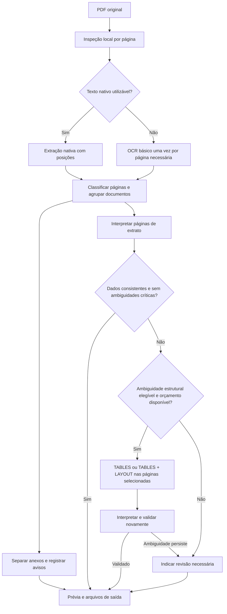

# Plano de leitura de PDFs compostos com OCR seletivo

Data: 16 de outubro de 2026. Estado: planejamento para implementação em PRs incrementais.

## Objetivo

Converter extratos escaneados que compartilham um PDF com notas fiscais, comprovantes e anotações a caneta. O resultado deve separar os documentos, preservar a origem de cada lançamento e avisar quando houver conteúdo diferente ou valores ambíguos.

O primeiro investimento será aproveitar palavras, posições e confiança do OCR básico. A análise de tabelas ficará desabilitada por padrão e será usada apenas nas páginas em que houver uma ambiguidade estrutural que ela possa resolver, dentro de um orçamento explícito.

## Evidências dos casos investigados

Os dois PDFs mensais investigados têm 8 e 10 páginas. Todas são imagens JPEG incorporadas, sem texto nativo ou desenhos vetoriais. Eles contêm extrato, anexos fiscais, comprovantes e anotações incorporadas à imagem. Renderizar páginas para inspeção não alterou os PDFs originais.

A conversão de produção terminou com alertas de consistência financeira; esses casos não foram falhas técnicas do worker. Entre os problemas observados, um traço manuscrito depois de um crédito foi interpretado como sinal negativo. Há também saldos de conta corrente e aplicações cuja interpretação exige identificar o escopo financeiro.

O teste com `AnalyzeDocument`, usando `TABLES` e `LAYOUT`, cobriu as duas primeiras páginas de cada PDF: quatro páginas, com cinco tabelas detectadas. Ele forneceu relações entre células e palavras úteis para distinguir alguns traços manuscritos dos valores impressos. Entretanto, manteve grande parte do texto anterior, agrupou vários lançamentos em uma célula e incluiu anotações em colunas financeiras. O adaptador atual não converteu esses resultados corretamente. O teste demonstra informação estrutural adicional; a correção financeira ainda precisa ser comprovada no documento inteiro.

O campo `TextType` deve funcionar como indício. Algumas anotações foram classificadas como impressas, e a AWS documenta suporte a manuscritos apenas em inglês. Excluir tudo que seja marcado como manuscrito também poderia excluir dados financeiros legítimos. Consulte os [limites de idiomas e formatos do Textract](https://docs.aws.amazon.com/textract/latest/dg/limits-document.html).

Os arquivos reais e os resultados de diagnóstico permanecem no armazenamento privado autorizado. Fixtures versionadas usarão documentos sintéticos, sem dados de clientes.

## Fluxo proposto

A inspeção local verifica estrutura, imagens, texto e qualidade da extração por página; contar caracteres não basta para considerar um texto utilizável. Um PDF pode combinar páginas vetoriais e escaneadas. As páginas que exigirem OCR serão enviadas em um PDF temporário contendo somente esse subconjunto, com um mapa para a numeração original. Enviar o PDF completo ao provedor cobraria também pelas páginas que se pretendia evitar.

A classificação usa a mesma extração já obtida. Não haverá uma chamada de OCR exclusiva para descobrir se existem notas fiscais ou manuscritos. Em uma página escaneada ainda desconhecida, o custo do OCR básico pode ser necessário para identificar seu conteúdo. Depois da identificação, anexos não entram na interpretação de extrato nem na escalada automática de tabelas.

Uma página de continuação sem cabeçalho herda contexto apenas quando houver evidência de continuidade. Contas, períodos e documentos diferentes recebem grupos separados. Se uma mesma página contiver regiões de tipos diferentes, registrar a mistura e bloquear a inclusão de regiões ambíguas em lançamentos até que sua separação seja validada.

## Pontos de integração

| Componente atual | Mudança planejada |
| --- | --- |
| `conversion/document_preflight_service.py` e `pdf_representation_classifier.py` | Acrescentar inspeção por página, preservando limites de upload, identidade e OCR existentes. |
| `conversion/document_extractor.py` e `conversion/statement_parser.py` | Introduzir extração estruturada antes da interpretação; manter a ponte legada para layouts existentes. |
| `document_extraction_models.py` e `textract_extraction_mapper.py` | Preservar palavras, geometria, confiança, tipo de texto e relações com linhas/células. |
| `document_type_classifier.py` e `document_routing_policy.py` | Classificar páginas e grupos, ampliar reconhecimento de NFS-e e decidir o tratamento de anexos. |
| `pdf_parser.py` e `textract_transaction_adapter.py` | Interpretar colunas e lançamentos usando posições e contexto; produzir evidências de ambiguidades. |
| `textract_gateway.py` | Analisar subconjuntos de páginas, retomar jobs e aplicar orçamento antes de iniciar chamadas. |
| `conversion/document_conversion_pipeline.py` | Orquestrar segmentação, validação, eventual escalada e persistência dos resultados. |

Hoje, `LegacyParsingServiceDocumentExtractor` já chama o parser e embrulha seu resultado. Apenas adicionar uma classificação depois dessa etapa seria tarde demais: anexos já poderiam ter virado lançamentos. A separação entre extração e interpretação deverá ser introduzida gradualmente no caminho de PDFs compostos.

O pipeline também aplica uma classificação inicial ao arquivo inteiro. Para PDFs compostos, uma nota fiscal no início não poderá provocar a rejeição antecipada de um extrato que esteja nas páginas seguintes. A política atual para arquivos inteiramente incompatíveis será preservada; o novo caminho decidirá com base no conjunto de páginas.

## Contratos de dados

Acrescentar campos opcionais, com valores padrão, aos modelos existentes. Os nomes abaixo são propostas de contrato para detalhar no primeiro PR de implementação.

| Entidade | Informação necessária |
| --- | --- |
| Palavra extraída | ID dentro da operação, texto, página original, posição, confiança e `TextType` opcional. |
| Linha e célula | IDs das palavras, geometria e relações; células também preservam spans e função de cabeçalho. |
| Página | Método de extração, tipo documental, confiança, evidências, grupo e alertas. |
| Grupo documental | Tipo, páginas originais, conta/período quando identificáveis e motivo de inclusão ou exclusão. |
| Lançamento | Grupo, página e palavras de origem, valor com sinal, data e ambiguidades de interpretação. |
| Saldo | Valor, data, escopo financeiro e evidência; distinguir conta corrente, aplicação e consolidado. |
| Tentativa de OCR | Conversão, páginas, modo, features, versão, job, estado, reserva de orçamento e custo estimado. |

O OCR básico já retorna blocos `WORD`, `LINE`, geometria, confiança e relações. O mapper atual preserva linhas e tabelas, mas não mantém palavras e seu `TextType` nos modelos internos. Preservar esses campos pode melhorar a interpretação sem outra chamada ao provedor. Os campos disponíveis estão descritos no [contrato Block do Textract](https://docs.aws.amazon.com/textract/latest/APIReference/API_Block.html).

IDs do provedor serão qualificados pela operação; IDs de duas extrações não podem ser combinados diretamente. A análise avançada complementa a extração básica e mantém sua proveniência, sem apagar a evidência anterior.

## Entregas e critérios de aceite

### 1. Referência manual e reprodução

Revisar todas as páginas dos dois PDFs, identificar grupos documentais e conferir manualmente datas, valores, sinais e escopos de saldo do extrato. Registrar pendências que a imagem não permita resolver. Criar fixtures sintéticas de extrato com anexos, notas de serviço, comprovantes e traços próximos aos valores.

Aceite: referência conferida por lançamento e página, reprodução do comportamento atual e distinção entre erro de OCR, erro de parser e ambiguidade do documento. As quatro páginas do teste avançado não serão tratadas como validação dos dois PDFs completos.

### 2. Preservação da extração básica

Adicionar palavras e relações aos modelos e ao mapper, com testes primeiro. Reutilizar os blocos já recebidos e persistir o resultado conforme a política temporária vigente. Introduzir o caminho de extração antes da interpretação, mantendo o adaptador legado para os demais casos.

Aceite: round-trip de palavras, posições e tipos de texto, compatibilidade com respostas sem esses campos e nenhuma chamada adicional de OCR ao ativar a preservação. Medir o ganho antes de implementar a escalada paga.

### 3. Classificação e separação de documentos

Classificar cada página e formar grupos com continuidade explícita. Reconhecer NF-e e NFS-e por múltiplos sinais, evitando depender apenas de uma chave de 44 dígitos. Identificar comprovantes e páginas desconhecidas. Preservar o original e o mapa de páginas; manter notas e comprovantes como anexos, sem transformá-los em novos movimentos do extrato.

Aceite: extrato seguido ou precedido de anexos gera apenas os lançamentos do extrato; nota fiscal isolada mantém o tratamento de documento incompatível. Páginas desconhecidas recebem aviso e não são descartadas silenciosamente. Extratos de contas diferentes permanecem separados; se a saída atual não suportar múltiplos grupos, informar essa limitação e impedir sua fusão.

### 4. Interpretação por posição e validação financeira

Usar colunas, alinhamento vertical, cabeçalhos repetidos e continuidade de datas para reconstruir lançamentos. Uma célula pode conter vários movimentos; uma linha visual pode continuar na página seguinte. Considerar a posição do traço e o papel da coluna antes de decidir o sinal. Usar `TextType` como evidência auxiliar, com tratamento explícito de ausência ou classificação incorreta.

Validar valores e datas contra a referência manual. Comparar saldos somente dentro do mesmo escopo financeiro. Não ajustar sinais ou criar movimentos para forçar o fechamento de saldo. Uma nota manuscrita ambígua deve gerar revisão, especialmente quando ela puder alterar um dado financeiro.

Aceite: os traços dos casos reproduzidos não invertem créditos; débitos impressos com sinal final continuam corretos; múltiplos valores são separados por posição; saldos de aplicação não viram saldo de conta corrente. A consistência de saldo será uma validação adicional, sem substituir a conferência de lançamentos.

### 5. Escalada seletiva e orçamento

Implementar uma política de elegibilidade que registre o motivo e as páginas selecionadas. Escalar somente se a extração básica deixar ambiguidade estrutural que tabelas ou layout possam esclarecer, como associação incerta entre coluna e valor. Manuscritos, anexos ou diferença de saldo, isoladamente, não autorizam uma chamada avançada. Uma falha conhecida do parser deve ser corrigida antes de pagar por outra extração.

Comparar `TABLES` com `TABLES + LAYOUT` nas fixtures e nos exemplos privados autorizados. Escolher a combinação de menor custo que produza ganho verificável. Não habilitar `FORMS` ou `QUERIES` neste fluxo.

Proposta para o piloto: flag desligada por padrão, no máximo duas páginas avançadas por conversão e uma análise lógica por página. Páginas de continuação também consomem esse limite. Reservar atomicamente o orçamento de páginas e dinheiro antes de iniciar o job; sem teto monetário configurado, preço válido para a região e tempo restante suficiente, não escalar. O limite de duas páginas é uma configuração inicial a validar, não uma estimativa de que todos os casos caibam nele.

Usar um PDF temporário com as páginas selecionadas e o fluxo assíncrono do gateway. O acesso de diagnóstico a `AnalyzeDocument` não comprova as permissões de `StartDocumentAnalysis` e `GetDocumentAnalysis` do worker; validar a role e atualizar IaC com o menor escopo necessário no PR correspondente. Respeitar os limites do produto, mesmo que os limites do provedor sejam maiores.

Aceite: PDFs já confiáveis fazem zero chamadas avançadas; orçamento esgotado, timeout ou permissão ausente produzem aviso controlado. Reentrega do worker retoma a tentativa existente. Uma ambiguidade persistente termina em revisão, sem um ciclo de novos OCRs.

### 6. Prévia, arquivos e implantação

Manter o fluxo de página única: upload, processamento, prévia e download. Exibir tipos documentais e páginas de cada grupo, quais anexos ficaram fora do extrato e quais dados exigem revisão. A numeração exibida será sempre a do original. Disponibilizar os anexos separados como PDFs derivados, sujeitos à mesma autorização e expiração do original; a separação usa as páginas existentes e não exige OCR adicional.

Campos novos na API serão opcionais. Manter o comportamento e os formatos existentes para documentos simples. Revisão financeira pendente deve impedir a apresentação de um OFX como validado; qualquer exportação parcial deverá identificar claramente seu alcance e depender da regra de produto vigente.

Aceite: o usuário entende que havia extrato e outros documentos no arquivo, encontra as páginas correspondentes e vê pendências antes de baixar. Validar textos em PT-BR, UTF-8, acesso aos derivados e uso em dispositivos móveis.

## Custos, retomada e armazenamento

Definir `C_b` como preço regional do OCR básico por página e `C_a(features)` como preço regional da combinação avançada escolhida. Para `N_b` páginas básicas e `N_a` páginas avançadas, o custo estimado será `N_b × C_b + N_a × C_a(features)`, somando eventuais outros provedores se utilizados. O preço avançado já inclui sua extração de texto; uma página enviada nas duas etapas gera os dois custos. Consultar os [preços do Textract](https://aws.amazon.com/textract/pricing/) para a região de produção antes do piloto, sem usar exemplos de outra região como tarifa local.

Exemplo: oito páginas escaneadas podem consumir oito páginas básicas para identificar seu conteúdo. Se duas páginas de extrato forem elegíveis, o total será oito básicas mais duas avançadas. As outras seis não recebem análise avançada. Se a interpretação básica resolver o extrato, o total permanece em oito básicas.

O gateway atual possui token idempotente por hash, modo e features, mas isso não substitui um registro durável de tentativa. A evolução deve manter estado por identidade/conversão, hash do conteúdo, páginas originais, modo, features e versão. Reservas concorrentes precisam impedir chamadas duplicadas; `job_id` e token estável permitem recuperar uma chamada cuja resposta se perdeu. Retomar polling ou busca de resultado não deve reiniciar a análise. Não prometer cobrança exatamente uma vez sem validar as garantias e a janela de idempotência do provedor.

Reutilizar resultados dentro da autorização da mesma identidade e do prazo vigente. Nenhum cache compartilhado entre clientes. Separar o cache de extração, que depende do conteúdo e modo, do resultado de interpretação, que depende também da versão do parser. Validar concorrência e isolamento das chaves temporárias de S3, hoje baseadas no hash do arquivo.

Preservar os prazos de retenção e exclusão existentes para originais e estendê-los aos subconjuntos, blocos e anexos derivados. Limitar volume de blocos persistidos, remover temporários ao concluir ou expirar e não colocar texto financeiro em logs. Se o registro de tentativas exigir schema, criar migração aditiva em PR próprio, com validação de upgrade, compatibilidade durante o deploy e rollback documentado.

## Matriz de validação

| Caso | Resultado esperado |
| --- | --- |
| Extrato vetorial conhecido | Nenhum OCR adicional; resultado compatível com a produção. |
| PDF híbrido com texto e imagem | OCR básico apenas nas páginas necessárias; numeração original correta. |
| Extrato escaneado simples | Uma extração básica por página necessária; zero escaladas. |
| Extrato com NF-e, NFS-e e comprovante | Anexos identificados; nenhum lançamento financeiro criado a partir deles. |
| Anexo nas primeiras páginas e extrato depois | Classificação inicial não rejeita o PDF inteiro indevidamente. |
| Traço manuscrito após crédito ou débito | Sinal definido pelo contexto e posição; dúvida explícita quando inconclusivo. |
| Anotação marcada como `PRINTED` ou sem `TextType` | Parser continua seguro sem depender de filtro absoluto de manuscritos. |
| Vários lançamentos na mesma célula ou entre páginas | Datas e valores associados corretamente, com origem preservada. |
| Conta corrente, aplicação e saldo consolidado | Saldos separados por escopo, sem movimentos inventados para fechar conta. |
| Duas contas, página desconhecida ou tipos misturados na mesma página | Grupos separados e limitações visíveis; nenhuma fusão silenciosa. |
| Escalada útil, inútil ou sem orçamento | Ganho medido por campo; limite respeitado; falha retorna revisão. |
| Timeout, resposta perdida, concorrência e reentrega | Job existente retomado; reserva única; sem loop de novas análises. |
| Acesso de outra identidade ou resultado expirado | Nenhum acesso ao original, blocos ou PDFs derivados. |

Nos PRs de implementação, seguir TDD e executar a suíte completa, Ruff e verificações de texto/navegação. Validar por HTTP o caminho de upload vigente (`POST /convert`), consulta e download, incluindo `GET /report/{analysis_id}` e um caminho negativo. O legado `POST /analyze` retorna 405 atualmente; manter essa compatibilidade e registrar a diferença em relação ao checklist histórico. Se a reconciliação mudar, incluir transferência interna, estorno e possível duplicidade.

## Implantação e rollback

Entregar as fases na ordem indicada, cada uma com PR próprio. As fases 2 a 4 devem demonstrar quanto o OCR básico resolve antes de liberar a fase 5. Iniciar a segmentação e a interpretação em modo de comparação, sem alterar a saída do usuário; depois habilitar para um conjunto controlado de conversões. A análise avançada terá flag independente e orçamento inicialmente zero.

Monitorar páginas por modo, páginas excluídas por tipo, motivo de escalada, reservas, custo estimado, duração, falhas, ambiguidades e correções verificadas contra a referência. Uma tabela com alta confiança do provedor não constitui evidência de acerto financeiro. A liberação exige acerto dos campos críticos no conjunto de referência, ausência de regressões conhecidas e custo dentro do teto configurado. Calibrar limiares e ganho mínimo com essas medições antes de ampliar o piloto.

Desabilitar primeiro a escalada paga em caso de aumento de custo, latência ou falhas. Reverter o caminho de PDFs compostos se houver regressão de interpretação, mantendo a indicação de revisão para os casos reconhecidamente ambíguos. Preservar a ponte legada e campos aditivos durante a implantação; suspender novas análises não pode apagar resultados nem reiniciar jobs em andamento.

O primeiro PR de desenvolvimento cobrirá a referência sintética e a preservação dos dados do OCR básico. Não é necessário habilitar o modo avançado globalmente para iniciar essas entregas.
