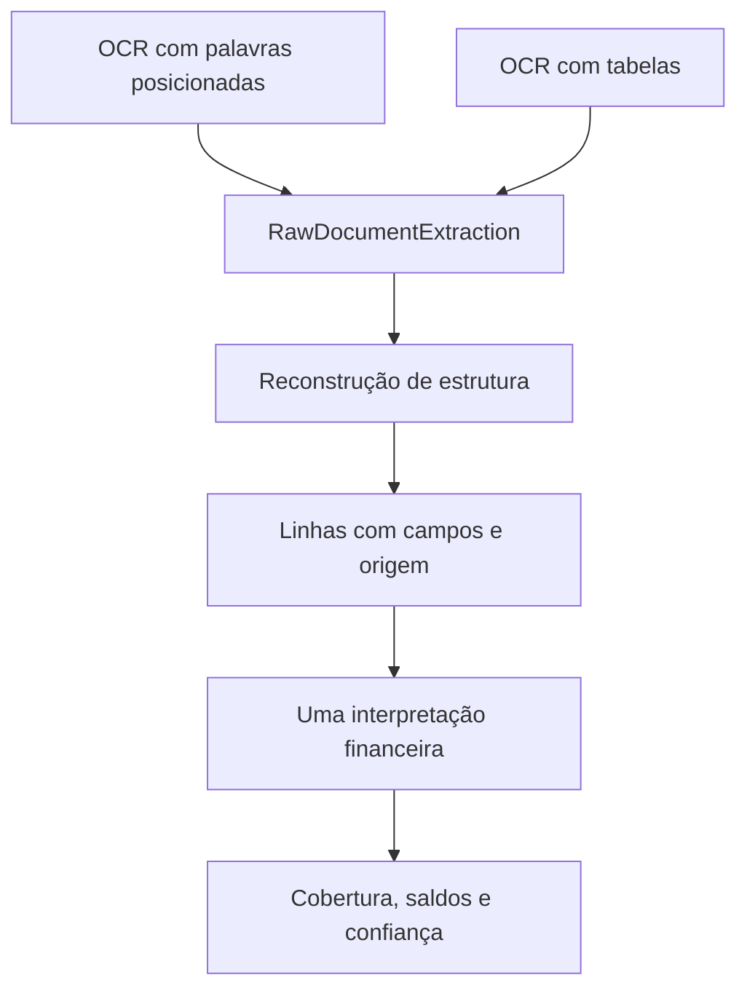

# OCR compartilhado e Conversão PRO assíncrona

Data: 31/10/2026. Integração autorizada; recurso entregue desligado para testes e implantação gradual.

## Resultado da avaliação

A referência é um extrato Asaas digitalizado de quatro páginas e 72 movimentos conferidos visualmente. A primeira página tem inclinação e descrições multilinha. Os resultados abaixo comparam a implementação anterior à integração e a estrutura compartilhada.

| Leitura Textract | Interpretação | Movimentos | Datas, valores, sinais, multiplicidade e páginas | Saldos impressos |
| --- | --- | ---: | --- | --- |
| DetectDocumentText | Leitor anterior | 53/72 | Faltam 19 movimentos da primeira página | Conferência não registrada |
| DetectDocumentText | Estrutura compartilhada | 72/72 | Iguais à referência, sem extras | Conferem |
| AnalyzeDocument, TABLES + LAYOUT | Adaptador anterior | 72/72 | Iguais à referência, sem extras | Conferência não registrada |
| AnalyzeDocument, TABLES + LAYOUT | Estrutura compartilhada | 72/72 | Iguais à referência, sem extras | Conferem |

A distribuição é 19, 25, 25 e 3 movimentos por página. As descrições compartilhadas são iguais entre palavras e células após normalizar espaços. Essa equivalência não certifica visualmente cada contraparte e descrição.

Na primeira página, o OCR retorna `Valor` antes de `Data` e `Movimentações`. O leitor anterior depende da ordem dos cabeçalhos; a reconstrução usa posições e resolve essa dependência. O ganho comprovado é recuperar 19 movimentos com uma interpretação financeira comum. Nesta amostra, **AnalyzeDocument não recuperou movimentos adicionais em relação ao texto reconstruído**. Por isso a análise mais cara depende de escolha explícita.

Os dois resultados continuam em revisão por baixa confiança em campos e controles. Saldos conferem sem ajuste de números, sinais ou repetições. O limiar de confiança é 90%; scores de WORD e CELL não estão calibrados como medidas equivalentes. Uma amostra não comprova desempenho universal.

## Arquitetura e alcance



- `ocr_structure.py`: reconstrói linhas com células ou palavras posicionadas, inclinação observada, cabeçalhos e âncoras independentes de data/valor. Preserva descrições multilinha e origem.
- `ocr_financial_interpretation.py`: interpreta as mesmas linhas nos dois modos, com Decimal, datas completas, sinais explícitos, controles impressos e linhas não resolvidas.
- `ocr_cash_statement.py`: aplica um único perfil semântico de caixa ao piloto Asaas e projeta no contrato atual de transações. Reutiliza a segmentação por períodos e a validação de continuidade existentes.
- O despacho de OCR Asaas de texto e tabelas usa essa projeção. PDFs nativos e demais famílias permanecem nos leitores existentes; evidência antiga sem geometria conserva o fallback existente.
- `pro_pdf_parser.py` seleciona o leitor pago e controla acesso/consumo. Não contém outro interpretador financeiro Asaas. Não altera `TEXTRACT_MODE` global.
- API e worker compartilham a consulta de assinatura em `active_plan_reader.py`. O import anterior continua disponível para compatibilidade; o worker não importa gestão administrativa de planos.

O núcleo estrutural não importa SDKs nem decide sinais. A interpretação financeira não seleciona fornecedor ou modo. Novas famílias exigem perfis semânticos compatíveis e evidência de validação, compartilhados pelos leitores; não se promete suporte universal.

A identificação documental separa instituição e titular também quando o OCR intercala o logo entre o nome e o CNPJ. Nomes exatos do catálogo de instituições não são candidatos a titular sem rótulo explícito. O salto sobre um logo exige que CNPJ e conta de origem compartilhem a mesma linha física; um CNPJ isolado do emissor não comprova o titular. Asaas está no catálogo como instituição de código 461, confirmado no [site oficial](https://www.asaas.com/sobre-nos). A regra de cabeçalho é compartilhada com outros bancos e preserva referências às páginas/linhas. O cadastro continua sendo reutilizado pelo CPF/CNPJ do titular dentro da organização. Conforme a preferência autorizada, o nome consistente do documento associado mais recente substitui um nome diferente salvo no mesmo cliente, inclusive ao atualizar recebimentos existentes; contas e vínculos são preservados. Identidades ambíguas, documentos diferentes e replays de arquivos anteriores não substituem o nome atual.

## Avisos proporcionais à evidência

A política comum aos OCRs de texto e tabelas preserva o limiar de confiança de 90%. Uma dúvida na data ou no valor produz um aviso apenas naquele campo e naquela linha. Confiança baixa não é declarada como erro de leitura. Dúvidas sobre os saldos lidos, estrutura e cobertura são avisos do documento, ancorados na primeira linha do contrato legado; a interface PRO os apresenta no topo, sem marcar todos os valores e descrições.

`ocr_balance_arithmetic_matches` informa exclusivamente que abertura lida + movimentos extraídos = fechamento lido. Não substitui `financial_controls_validated`, não confirma cobertura integral, não altera valores nem promove saldos incertos a limites verificados para exportação. A interface suprime essa indicação positiva diante de divergência, extração parcial ou continuidade não confirmada. Edições invalidam a indicação da extração original; alterações locais de valores também a ocultam antes do salvamento.

`ocr_review_fields_count` e `ocr_review_rows_count` informam os pontos de confiança baixa. A interface mostra a data ou o valor afetado em amarelo; divergências financeiras mantêm aviso de erro. A regra independe do modo pago. Resultados históricos sem avisos específicos mantêm seus avisos genéricos: não há reanálise paga automática nem reconstrução fictícia de confiança por campo.

Blocos mensais preservam movimentos repetidos e páginas físicas. Lacunas, sobreposições, cobertura incerta ou controles incompatíveis exigem revisão. Não se inventam mês, ano, valor, sinal ou conta. Débito/crédito separados, faturas e eventos sem efeito de caixa precisam de semântica própria. Curvatura, perspectiva e rotações extremas não foram avaliadas. Âncoras reconhecidas não provam que o OCR enxergou cada transação impressa.

## Fluxo na aplicação

Na tela **Nova conversão**, `Padrão` continua selecionado. Quando habilitada no servidor, aparece **Conversão PRO**, disponível somente para assinatura paga ativa.

1. Selecionar Conversão PRO e enviar um PDF digitalizado do piloto Asaas.
2. `Verificar Conversão PRO` envia o arquivo e consulta suas páginas reais sem chamar Textract nem reservar franquia PRO.
3. A tela informa páginas, consumo da franquia normal e do limite PRO, saldo previsto e possibilidade de revisão/falha.
4. `Iniciar Conversão PRO` submete à fila existente. O worker revalida acesso, tipo, páginas e limites antes do OCR.

| Regra | Implementação |
| --- | --- |
| Plano | Essencial, Profissional ou Escritório com assinatura ativa; verificação no servidor |
| Gratuito | Recusado antes da leitura paga, inclusive via requisição direta |
| Arquivos | Um PDF por solicitação |
| Páginas | Menor limite entre OCR do plano e `CONVERSION_PRO_MAX_PAGES`, limitado a 6 |
| Limite PRO | `CONVERSION_PRO_MONTHLY_PAGES`, padrão 20 por usuário e mês calendário UTC; data de renovação exibida |
| PDF com texto confiável | Recusado na opção PRO antes de chamar AWS; usar Padrão |
| PDF misto/camada OCR | Classificação existente decide a necessidade visual |
| Consumo | Reserva PRO das páginas reais antes de chamar; franquia normal segue contabilização existente |
| Falha após iniciar o job | O documento inteiro conta como tentativa, mesmo sem resultado; leitura parcial não é apresentada como completa |
| Rejeição definitiva no início por entrada/permissão AWS | Todas as páginas reservadas são liberadas |
| Timeout/resposta incerta | Tentativa continua contabilizada; não presumir ausência de cobrança |
| Repetição | Sem retry automático da análise; ClientRequestToken por proprietário/job/documento protege o início. Nova tentativa exige novo envio explícito |

Não há cobrança avulsa nova. O limite é um orçamento técnico separado dentro do plano pago. A opção não garante extração completa nem liberação da revisão.

## Leitura e persistência

`AsynchronousTextractReader` envia o PDF original inteiro, sem divisão por página, e inicia um único `StartDocumentAnalysis(TABLES, LAYOUT)`. O worker consulta `GetDocumentAnalysis` até a conclusão e percorre todos os `NextToken`. O contrato comum preserva as páginas físicas e os IDs/Relationships originais do resultado. Não há chamada síncrona nem OCR de texto antes da análise. Limites comerciais do plano continuam válidos; o limite técnico de uma página do Textract síncrono não se aplica a esse fluxo.

A fila/polling do produto e a API Textract usada pelo worker são assíncronos. IAM requer `textract:StartDocumentAnalysis` e `textract:GetDocumentAnalysis`, além do acesso S3 já utilizado. Não requer `textract:AnalyzeDocument`. A leitura padrão conserva suas APIs/permissões de texto. SDK sem retry automático e token idempotente evitam repetição paga silenciosa. Resultados parciais, páginas não confirmadas e paginação incompleta não são liberados como extração completa. Referências das APIs: [StartDocumentAnalysis](https://docs.aws.amazon.com/textract/latest/APIReference/API_StartDocumentAnalysis.html) e [GetDocumentAnalysis](https://docs.aws.amazon.com/textract/latest/APIReference/API_GetDocumentAnalysis.html).

A cópia temporária exclusiva é removida com sua versão quando o job termina ou quando o início é definitivamente rejeitado. Em bucket versionado, o worker precisa também de `s3:GetObjectVersion` para a versão enviada ao Textract e `s3:DeleteObjectVersion` para sua limpeza, limitados ao prefixo temporário. Se a resposta do início se perder, ou a consulta falhar enquanto o job pode estar em execução, o arquivo é mantido para não interromper a leitura aceita pela AWS. O prefixo temporário precisa estar coberto pela política de expiração do bucket; o log operacional identifica o job e a chave retida. Não excluir essa entrada antes de confirmar o estado final do job.

Persistência aditiva:

- `conversion_jobs.ocr_mode TEXT NOT NULL DEFAULT 'standard'`; jobs antigos e escritores antigos conservam o padrão.
- `conversion_pro_usage`: job, proprietário, mês UTC, reserva, tentativas iniciadas e estado. Reserva atômica usa transação e trava por proprietário no PostgreSQL; SQLite usa transação imediata. O início assíncrono marca todas as páginas em uma atualização atômica, com conferência do proprietário e do estado.
- Reentrega da fila não inicia nova leitura paga. Após início, tentativa interrompida não tem retomada automática nem cache persistente por página. Uma morte abrupta pode deixar reserva retida; investigar o job antes de qualquer liberação manual. Não reaplicar o job para resolver isso.
- Nenhuma opção foi inserida no JSON de preflight, que precisa continuar legível por versões antigas.

## Implantação e rollback

Configuração padrão em API e worker:

```dotenv
CONVERSION_PRO_ENABLED=false
CONVERSION_PRO_MAX_PAGES=6
CONVERSION_PRO_MONTHLY_PAGES=20
```

1. Aplicar a migração `20261031_01` após `20261029_01`. Ela adiciona coluna com default, tabela e índice; não remove ou renomeia dados.
2. Publicar API e todos os workers compatíveis com a flag desligada. Configurar bucket temporário, expiração do prefixo, região e IAM para StartDocumentAnalysis/GetDocumentAnalysis assíncronos. Atualizar o frontend para reconhecer o modo PRO nas falhas e orientar um novo envio explícito.
3. Encerrar execuções de workers antigos antes de habilitar `CONVERSION_PRO_ENABLED=true` na API e nos workers do ambiente de testes/piloto. Conferir opções, confirmação, quota e resultado.
4. Monitorar tentativas por job/proprietário, falhas, limpeza temporária, consumo e revisão. Conferir custo efetivo na AWS; não inferir precisão pela taxa de revisão.
5. Rollback: desabilitar novas solicitações, drenar/concluir ou cancelar jobs PRO e resolver reservas antes de restaurar workers antigos. O downgrade da migração conserva coluna e histórico intencionalmente. O retorno do código não reverte consumos.

Validação em PostgreSQL 16 local isolado: upgrade repetido, job preexistente, escritor antigo após upgrade, job PRO, downgrade sem perda do histórico e escritor antigo após downgrade. Operações aditivas podem aguardar lock de DDL em tabela ativa; aplicar com limite de espera e acompanhar bloqueios. Não houve migração nem implantação em produção nesta tarefa.

## Experimento original autorizado e custos

Foram oito chamadas pagas em `us-east-1`, quatro DetectDocumentText e quatro AnalyzeDocument síncronos, no mesmo documento. Nenhuma API Start. Páginas separadas preservaram os pixels originais; não houve retificação, binarização ou aumento de resolução. Quatro cópias S3 exclusivas e suas versões foram removidas. Ajustes posteriores usam respostas salvas, sem novas chamadas pagas.

Na troca posterior para o fluxo assíncrono, os testes de SDK/HTTP validam um único PDF, StartDocumentAnalysis e todos os resultados paginados por GetDocumentAnalysis. O replay offline das respostas salvas conserva 72 movimentos e as mesmas datas/valores/páginas; isso não mede uma nova extração assíncrona na AWS. A tentativa de validação real foi recusada por falta de StartDocumentAnalysis no perfil local de diagnóstico, antes de criar um JobId; a cópia temporária dessa tentativa foi removida. A permissão desse perfil é distinta da role de execução do worker. Não houve fallback para API síncrona.

Tempos agregados observados: texto 16,090 s; análise 25,308 s, incluindo overhead do CLI. Não são benchmark de produção. Os modos retornaram as mesmas palavras/linhas; análise acrescentou quatro tabelas e 228 células.

Catálogo oficial regional publicado em 27/10/2026, primeira faixa até um milhão de páginas/mês:

| Operação | US$/página | Quatro páginas |
| --- | ---: | ---: |
| DetectDocumentText síncrono | 0,0015 | 0,0060 |
| AnalyzeDocument, TABLES + LAYOUT | 0,0150 | 0,0600 |

LAYOUT incluído com TABLES; FORMS não solicitado. Oito chamadas: referência de **US$ 0,0660**, excluindo impostos, descontos/franquias e S3. Vinte páginas de Tables equivalem a aproximadamente US$ 0,30 nessas condições, sem garantia de margem nem de custo técnico após interrupções.

Fontes: [catálogo regional](https://pricing.us-east-1.amazonaws.com/offers/v1.0/aws/AmazonTextract/current/us-east-1/index.json), [preços](https://aws.amazon.com/textract/pricing/), [limites síncronos](https://docs.aws.amazon.com/textract/latest/dg/limits-document.html), [AnalyzeDocument](https://docs.aws.amazon.com/textract/latest/APIReference/API_AnalyzeDocument.html).

## Reprodução e validação

PDFs, referências visuais, respostas OCR e relatórios ficam em `local/pdf-review-six-20261031/`, ignorado pelo Git. Nenhum dado financeiro de cliente integra a PR. O avaliador usa o leitor legado explicitamente para manter a comparação anterior à integração:

```powershell
backend\venv\Scripts\python.exe scripts\evaluate_ocr_structure.py `
  --source '<PDF privado>' `
  --text-result '<resposta de texto recomposta>' `
  --analysis-result '<resposta de análise recomposta>' `
  --reference '<CSV de conferência visual>' `
  --reference-filename '<nome do PDF no CSV>' `
  --output local/ocr-comparison
```

CSV: `;`, UTF-8, campos `file`, `date` (`dd/mm/aaaa`), `amount` (decimal com ponto e sinal), `page`. Respostas: Blocks e DocumentMetadata.Pages, IDs exclusivos por página. A referência avalia resultados e nunca alimenta a interpretação.

Testes cobrem texto/tabelas/outro fornecedor, inclinação, ordem, repetições, células incompletas, sinais fragmentados/conflitantes, campos ilegíveis, falta de geometria/cabeçalho, página posterior, confiança, períodos contínuos/com lacuna e origem. Integração cobre assinatura, concorrência de orçamento, mês UTC, falha parcial, idempotência, estimativa e HTTP real com worker e downloads. SDK simulado valida chamadas/cópias/limpeza sem custo AWS adicional. A comparação offline real mantém 72/72 nos dois modos com revisão por confiança preservada.

Comandos e resultados finais das suítes, lint e HTTP estão registrados em `How to test` da PR.
