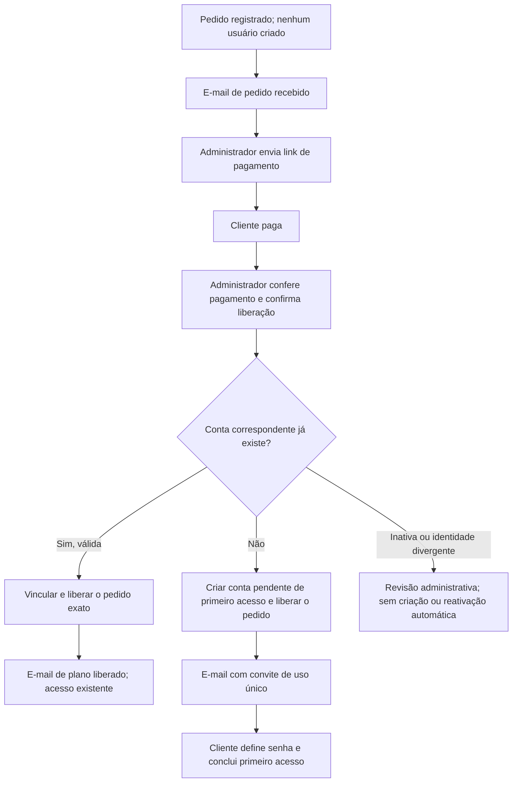

# Compra, e-mails HTML e primeiro acesso — proposta

Status: modelos para avaliação e plano de implementação. Este pacote não altera as rotas, não envia mensagens e não cria contas. Decisões confirmadas pelo responsável: o cliente informa um e-mail, mas pode ainda não ter conta no OFX Simples; o primeiro acesso será por link para definir a senha; a conta só pode ser criada pela ação de liberação do administrador.

## Experiência proposta

1. O cliente informa os dados da compra. O sistema registra **um pedido**, sem criar usuário, e envia a confirmação do recebimento.
2. O administrador revisa o pedido e informa o link. O cliente recebe o e-mail HTML com **Pagar agora**, o endereço visível e **Abrir página para copiar o link**.
3. Depois de conferir o pagamento, o administrador abre **Liberar plano**. O painel mostra o e-mail que receberá o plano e se uma conta já existe.
4. Se já existe uma conta válida, a liberação usa essa conta e envia **Seu plano está liberado**. Senha e forma de login existentes permanecem válidas.
5. Se não existe conta, o administrador confirma **Criar conta e liberar plano**. A mesma operação cria a conta pendente de primeiro acesso, vincula o pedido, ativa o plano e registra o convite para definir a senha.
6. O cliente recebe **Definir minha senha e começar**, escolhe a senha e confirma os dados/termos necessários. A conta passa a estar pronta para login.

O link de e-mail nunca cria a conta nem confirma um pagamento. Sua abertura apenas apresenta a tela correspondente. A criação acontece na ação administrativa autenticada; a conclusão do primeiro acesso usa um POST explícito do cliente.

Essa restrição vale para a criação automática originada da compra. O cadastro voluntário já existente continua disponível e deve ser considerado nos testes de concorrência.

## Modelos entregues para avaliação

Abra [a galeria local](../marketing/templates/purchase-flow/index.html). Cada mensagem tem HTML, alternativa de texto, assunto e preheader. Os dados do pedido são fictícios.

| Modelo | Momento | Ação principal |
| --- | --- | --- |
| `01-pedido-recebido` | Pedido registrado | Entender os próximos passos e falar com suporte |
| `02-link-pagamento` | Administrador envia o link | Pagar agora ou abrir a página de cópia |
| `03-plano-liberado` | Liberação para conta existente | Entrar com o acesso atual |
| `04-primeiro-acesso` | Conta criada na liberação | Definir a primeira senha |
| `05-aviso-administrador` | Novo pedido | Revisar no painel, sem liberar pelo link |

Identidade: azul `#003ec7`, fundo `#f2f5fa`, cartão branco de até 600 px, Arial, cantos arredondados e cabeçalho tipográfico dos templates de marketing. As mensagens de compra são transacionais: não carregam ofertas de afiliados nem dependem de adesão ao marketing. Criar conta não habilita `product_updates_opt_in`.

## WhatsApp e pagamento

O número vem de `WHATSAPP_SUPPORT_NUMBER`, já exposto por `GET /public-config` e validado em `backend/app/routers/public_config.py`. Na consulta pública de 12/11/2026, o valor era `5511911808493`, mostrado na prévia como **+55 (11) 91180-8493**. O valor em `flow.json` é somente uma fotografia da configuração para a avaliação offline, não uma nova configuração do produto.

Na integração, o backend lê a variável, valida os dígitos, formata o número para exibição e gera `https://wa.me/{numero}?text={mensagem_codificada}`. A mensagem contém apenas o identificador público do pedido, sem credencial ou link de primeiro acesso. Se a configuração estiver ausente ou inválida, o renderer omite o bloco de WhatsApp e mantém o contato por resposta ao e-mail. Nunca usar `customer_whatsapp` como número do suporte.

O botão **Pagar agora** usa o link validado que o administrador gravou no pedido. Nome, preço e periodicidade vêm do retrato do pedido, para preservar as condições da compra mesmo que o catálogo de planos mude.

**Copiar no e-mail:** a cópia programática depende de JavaScript, que não é suportado de forma confiável nas caixas de entrada. A solução proposta é um link com o texto **Abrir página para copiar o link**, que abre uma página do OFX Simples com **Copiar link**, o endereço selecionável e a opção de pagar. Essa escolha segue as [limitações de HTML de e-mail documentadas pelo Mailchimp](https://mailchimp.com/help/limitations-of-html-email/).

Na página futura, o botão chama `navigator.clipboard.writeText` após o clique; se o navegador negar, seleciona o endereço e explica como copiar manualmente. O GET não altera pedido, conta ou pagamento.

Para pedidos sem login, usar um token próprio de visualização do pagamento, aleatório, expirável, revogável e limitado a esse pedido. Não usar o ID previsível do pedido como autorização; não reutilizar convite de senha, sessão, token de usuário ou descadastro. Não aceitar uma URL de pagamento arbitrária em query string. A página consulta o link atual no servidor, informa pagamento já liberado/link indisponível quando aplicável e exibe somente os dados mínimos. Evitar analytics e vazamento por referer; usar `Cache-Control: no-store` e `Referrer-Policy: no-referrer`. O prazo desse acesso será limitado pela validade informada para o link de pagamento, com possibilidade de revogação pelo administrador.

## Diferenças em relação ao código atual

| Código existente | Consequência para a implementação |
| --- | --- |
| `POST /checkout/intents` exige um usuário autenticado | Um comprador sem conta ainda não consegue iniciar esse fluxo. Criar a entrada de pedido sem login, sem criar usuário, é uma etapa explícita do plano. |
| A estrutura já admite pedidos legados com `user_id` vazio | Preservar essa representação e testar ambos os bancos; não usar isso para criar usuários durante leitura/listagem. |
| A liberação procura a conta por `user_id` e, na ausência, por e-mail; se não achar, retorna 404 | A criação precisa de uma operação administrativa específica, com confirmação e auditoria. |
| `activate_user_plan` pode marcar o pedido mais recente do mesmo usuário/plano | A nova liberação deve operar sobre o **intent_id selecionado**, sem liberar outro pedido pendente. |
| `register_user` pode inferir administrador pelo e-mail configurado e verificação pela flag global | Não chamá-lo diretamente para provisionar compradores. O caminho novo deve forçar `is_admin=false`, não emitir sessão e aguardar comprovação do e-mail. |
| O serviço de contato envia `text`, sem argumento HTML | Adicionar suporte opcional a `html`, preservando todos os chamadores de texto e enviando as duas versões no mesmo e-mail. |
| Recuperação de senha já tem token com hash, expiração, consumo único e revogação de sessões | Reaproveitar as regras e primitivas, não o token nem a finalidade. O primeiro acesso requer ciclo próprio. |

Pontos de entrada: `backend/app/routers/checkout.py`, `backend/app/application/access_control/access_control_checkout.py`, `backend/app/application/access_control/access_control_auth.py`, `backend/app/application/access_control/access_control_password_reset.py` e `backend/app/application/contact_service.py`.

## Pedido sem conta

Manter o checkout autenticado funcionando. Introduzir a entrada de pedido como visitante atrás de uma flag, com `user_id=NULL`, validação de nome/e-mail/plano, aceite explícito dos termos do pedido, proteção contra abuso e chave de idempotência. O servidor resolve plano e valor; não confia em preço enviado pelo navegador.

A resposta pública não deve informar se o e-mail já tem conta. O visitante acompanha a comunicação por e-mail; o simples preenchimento de um endereço não permite listar pedidos ou arquivos associados a ele. A área do cliente continua exigindo sessão. Um pedido registrado manualmente pelo administrador pode reutilizar o mesmo registro de intenção, igualmente sem criar usuário antes da liberação.

Se existir `user_id`, ele continua sendo a identidade de referência. Divergência entre o e-mail do pedido e a conta exige resolução explícita no painel antes de enviar dados de acesso ou provisionar outro usuário. Não transferir plano por correspondência silenciosa com outro e-mail. Normalizar e-mail como no sistema atual (trim e caixa); não inventar equivalências entre aliases.

## Liberação administrativa e criação atômica

O painel apresenta, antes de confirmar: pedido exato, plano/valor, e-mail de destino, conta encontrada e efeito da operação. Exibe **Criar conta e liberar plano** somente se não houver conta correspondente; para conta existente, **Liberar plano**.

Proposta de extensão compatível de `POST /admin/checkout/intents/{intent_id}/release`: corpo opcional com `request_id`, `confirm_payment`, `create_missing_user` e `expected_customer_email`. A criação é negada por padrão quando os campos novos não forem enviados. O contrato antigo para contas existentes é preservado durante a transição; nenhum cliente antigo passa a criar contas implicitamente.

Dentro de uma única transação de aplicação:

1. Exigir administrador autenticado e registrar seu identificador. Confirmar a intenção explícita de liberação/pagamento e conferir se o e-mail não mudou desde a prévia.
2. Bloquear o pedido e verificar se já foi liberado. Repetir a mesma requisição retorna o resultado anterior, sem renovar vigência/quota, criar outra conta ou emitir outro convite.
3. Resolver conta de forma consistente. Conta inativa/suspensa exige tratamento separado; conta Google mantém seu provedor e recebe o e-mail para acesso existente.
4. Se não houver conta e o administrador confirmou a criação, inserir um usuário comum com primeiro acesso pendente, e-mail ainda não verificado e nenhum consentimento de marketing. Gerar internamente uma credencial aleatória não utilizável/conhecida pelo cliente, armazenar somente o hash e descartar o segredo; nunca enviar uma senha por e-mail.
5. Usar a unicidade do e-mail no banco para impedir duas contas em liberações concorrentes. Após conflito, reler e reavaliar a conta existente, sem redefinir sua senha, permissões ou provedor.
6. Vincular a conta ao pedido selecionado, ativar o plano e registrar a liberação desse pedido. Reaproveitar as regras atuais de vigência; a criação de conta não cria uma segunda assinatura.
7. Registrar o convite de primeiro acesso, quando necessário, e uma notificação pendente, com chave única por pedido/evento/versão. Registrar a autoria na trilha de auditoria.
8. Confirmar a transação antes de falar com o provedor de e-mail. Uma falha na transação não deixa conta, plano ou pedido parcialmente liberado.

O envio é uma etapa posterior. Falha de e-mail não desfaz pagamento conferido nem plano liberado. O painel distingue **Plano liberado — e-mail pendente/falhou** de **E-mail aceito pelo provedor**, com ação de reenvio. Aceitação não é confirmação de entrega na caixa de entrada.

## Primeiro acesso por link

O convite será destinado somente à conta criada na liberação administrativa. O cliente escolhe sua senha; o administrador não conhece nem define uma senha para uso do cliente.

- Proposta: token aleatório de 32 bytes, finalidade `account_setup`, hash no banco, uso único e validade configurável inicialmente de **24 horas**. Esse prazo é uma decisão de produto proposta, não a validade atual dos tokens de recuperação (30 minutos).
- Vincular ao usuário, pedido e administrador que emitiu. O link vai para uma origem HTTPS fixa/configurada, nunca derivada de um `Host` fornecido pelo cliente.
- Abrir o e-mail ou a página não consome o token: leitores automáticos não devem concluir o primeiro acesso. Consumir somente no POST de confirmação, na mesma transação que define a senha, confirma o controle do e-mail e encerra o estado pendente.
- Aplicar a política de senha do sistema, limite de tentativas e expiração. Não expor tokens em logs, auditoria, URLs de analytics ou no painel administrativo. Reutilizar a abordagem de token no fragmento da página já usada na recuperação, removendo-o da barra de endereço depois de carregado.
- Contas pendentes não recebem sessão nem acesso às conversões antes da conclusão. Essa regra precisa valer para login, cookies, tokens legados, recuperação de senha, cadastro concorrente e associação OAuth; não depender apenas da flag global de verificação de e-mail.
- No primeiro acesso, confirmar termos/privacidade ainda não aceitos pelo cliente. Se existir evidência válida do aceite no checkout, preservá-la; nunca preencher um aceite em nome do cliente. Marketing permanece opcional, separado e desmarcado.
- Após concluir, invalidar outros convites e sessões anteriores, atualizar a versão de credencial e levar o cliente ao login normal. Não emitir sessão automaticamente só pela abertura do link.
- Convite expirado: orientar contato com suporte. Reemissão pela ação administrativa autenticada, sem criar outra conta ou reativar o plano. Uma reemissão explícita invalida o convite anterior; tentativas técnicas do mesmo envio preservam a mesma chave de idempotência e conteúdo.

Essas decisões adaptam as orientações de tokens seguros, uso único e expiração da [OWASP](https://cheatsheetseries.owasp.org/cheatsheets/Forgot_Password_Cheat_Sheet.html) ao primeiro acesso. A infraestrutura atual de recuperação continuará com sua finalidade e comportamento próprios.

## Persistência e envio de e-mails

Proposta aditiva, a detalhar na implementação:

| Estrutura | Finalidade e compatibilidade |
| --- | --- |
| `users.initial_access_pending` | Booleano com default falso; contas existentes continuam com seu comportamento atual. |
| `account_setup_tokens` | Hash único, usuário/pedido, administrador, criação, expiração, consumo, invalidação e estado de envio. Não armazena senha nem token em claro. |
| `checkout_notifications` | Evento, pedido, destinatário, versão do template, chave de idempotência, estado, tentativas, ID do provedor e erro sanitizado. Unicidade impede emissão duplicada do mesmo evento. |
| Tokens de visualização do pagamento | Finalidade restrita, hash/expiração/revogação, separados de convites e credenciais. |

Não persistir o corpo com um convite secreto em texto aberto na tabela de notificações. O segredo existe em memória para a primeira tentativa; se houver necessidade de entrega durável entre processos, armazenar o payload somente cifrado com chave externa, prazo de retenção e exclusão após entrega/expiração. Se a primeira versão adotar apenas reenvio administrativo, uma interrupção sem segredo recuperável deixa o convite pendente para reemissão explícita. Não regenerar silenciosamente um token a cada retry e invalidar um e-mail que o cliente já recebeu.

Propor renderização transacional própria, com HTML e texto, escape de campos e validação de URLs. A [API do Resend aceita HTML e texto](https://resend.com/docs/api-reference/emails/send-email) na mesma mensagem. O envio continua usando o serviço de e-mail do backend; o worker de extração financeira não participa desse fluxo.

O renderer deve rejeitar campos obrigatórios ausentes e marcadores não substituídos. Não colocar dados pessoais em cabeçalhos sem validação. Validar/escapar URLs para evitar conteúdo executável ou redirecionamento arbitrário. Os HTMLs usam tabelas e estilos inline; o JavaScript existe somente na galeria e na futura página de cópia, nunca no corpo do e-mail.

## Implementação em etapas

| Etapa | Entrega | Condição para avançar |
| --- | --- | --- |
| 0 — Avaliação, este PR | Cinco modelos, galeria responsiva, demonstração da cópia e este plano | Aprovação do conteúdo e visual pelo responsável |
| 1 — E-mails HTML | Renderer, HTML + texto no serviço, WhatsApp por variável e templates de recebimento/pagamento | Fluxo atual preservado; testes de provedor e envio aprovado para destinatário de teste |
| 2 — Pedido visitante e página de pagamento | Registrar intenção sem usuário, proteção de acesso e cópia do link | Nenhum usuário criado pelo checkout; pedidos existentes e área do cliente preservados |
| 3 — Liberação e primeiro acesso | Migração aditiva, confirmação no admin, operação atômica, convite e conclusão de senha | Corridas/idempotência/autorização validadas; provisionamento somente no admin |
| 4 — Operação | Estado separado de envio, reemissão administrativa, alertas e rollout gradual | Falhas recuperáveis sem duplicar conta, plano ou mensagem |

A etapa 1 pode entrar antes da criação automática de contas. O template 04 só entra em uso quando a etapa 3 estiver implantada. O link para a página de cópia só entra nos envios reais depois que sua rota existir; até lá, o e-mail mantém o link direto selecionável. Nenhum placeholder de rota futura deve ser enviado ao cliente.

## Critérios de aceite e regressão

| Caso | Resultado esperado |
| --- | --- |
| Conta existente local ou Google | Usar a conta atual; não alterar senha, papel ou provedor. |
| Cliente sem conta registra pedido ou recebe link | Nenhum registro de usuário criado. |
| Cliente comum chama liberação/criação/reemissão | 401/403; nenhum usuário, plano ou convite criado. |
| Administrador libera compra sem conta | Exatamente uma conta comum pendente, um pedido liberado, plano correto e convite. |
| Dois cliques/administradores; cadastro concorrente com mesmo e-mail | Uma conta por e-mail; pedido exato; nenhuma senha ou assinatura duplicada. |
| Mesmo usuário com vários pedidos abertos | Somente o pedido selecionado é liberado. |
| Conta inativa, e-mail divergente ou pedido já liberado | Sem reativação, reassociação ou renovação silenciosa. |
| Falha de banco | Rollback completo da liberação/criação. |
| Falha do provedor depois de liberar | Estado de envio explícito; reenvio sem recriar conta ou renovar plano. |
| Token inválido, expirado, reutilizado ou de outra finalidade | Primeiro acesso recusado, sem sessão ou alteração de senha. |
| Scanner abre o link | Nenhum efeito; consumo apenas em confirmação POST. |
| Primeiro acesso concluído | Senha definida pelo cliente, e-mail comprovado, aceite real e login normal disponível. |
| WhatsApp ausente/inválido; link ou nome com caracteres especiais | Bloco opcional omitido; HTML seguro e texto legível. |
| HTML desativado no leitor | Alternativa de texto contém as mesmas instruções e links. |
| Navegador nega clipboard; tela de 320 px | Endereço selecionável, explicação de cópia manual e nenhum corte horizontal. |

Validar também envio em Gmail, Outlook e Apple Mail com destinatários autorizados antes do rollout; a prévia em Chromium não substitui a renderização nas caixas de entrada. Nos PRs de API, executar HTTP real para checkout/liberação/primeiro acesso, `/convert` + relatório e caminhos negativos; `/analyze` está desabilitado na aplicação atual. Executar suíte completa e linters conforme o AGENTS.md.

## Rollout, migração e rollback

As migrações futuras devem ser aditivas e idempotentes, sem DROP/RENAME ou alteração destrutiva de usuários/pedidos existentes. Testar upgrade em SQLite e PostgreSQL com dados anteriores, inclusive pedidos sem `user_id`, contas Google, inativas e usuários com múltiplas compras. Não há backfill de contas ou convite automático para pedidos antigos.

Primeiro implantar a leitura dos campos novos e o bloqueio de primeiro acesso em todas as versões/processos de autenticação. Depois aplicar/validar a migração e somente então habilitar o provisionamento no admin por flag. Manter flags independentes para HTML, checkout visitante e criação administrativa. Não habilitar a criação enquanto houver instâncias antigas capazes de ignorar o estado pendente. Avaliar locks de índices/constraints com volume semelhante à produção; evitar varredura e backfill no caminho de requisição.

Rollback operacional: desabilitar novos pedidos visitantes/provisionamentos, preservar contas/planos já criados e manter as rotas para concluir convites existentes. Voltar o envio para texto se necessário, mantendo a proteção de acesso. **Não voltar a uma versão de autenticação que ignore contas pendentes** enquanto existirem essas contas; nesse caso, usar uma versão de compatibilidade com o bloqueio ou concluir/remediar os pendentes antes do rollback. Não excluir tabelas/convites ativos nem desfazer pagamentos para reverter o código.

Observar contagem de notificações pendentes/falhas, contas pendentes, expiração/reemissão e conflito de liberação, com IDs técnicos e erros sanitizados. Após deploy, validar pedido fictício autorizado, liberação com conta existente e sem conta, primeira senha, reenvio e bloqueio de criação por não administrador. Os planos de upgrade e rollback devem ser testados e registrados no PR de migração antes de ativar a flag.

## O que avaliar agora

Revisar as cinco mensagens na galeria, principalmente o texto do pagamento, o destaque do WhatsApp, os caminhos de acesso existente/novo e a transição do e-mail para a página de cópia. A criação administrativa e o primeiro acesso por link já estão confirmados como requisitos. O prazo inicial de 24 horas e a ordem das etapas de rollout permanecem propostas para a implementação.
