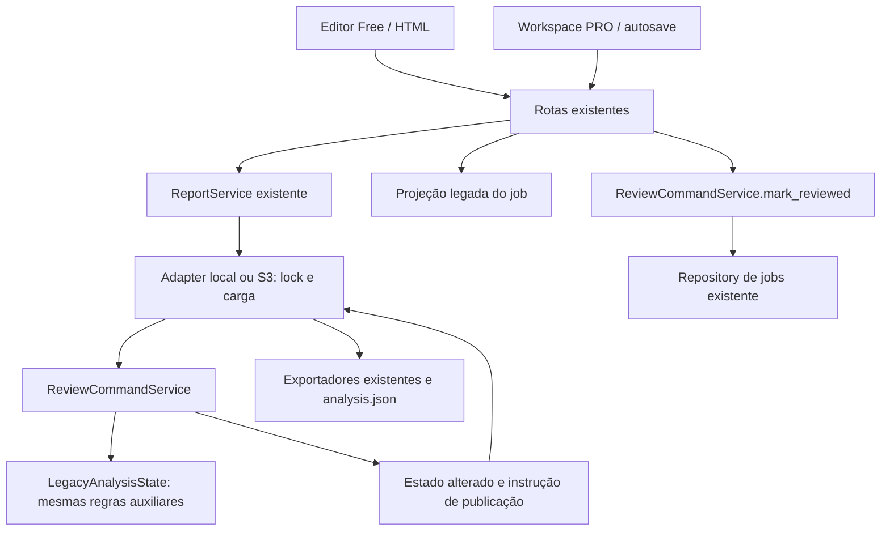

# OFX-68 — Serviço único de comandos de revisão

Data: 02/11/2026. Referência anterior: `c2ca8abafc087485992c77d60cadc8d4b26740f1`
(main com OFX-67/PR #533 integrado). Escopo: fase 1 da alternativa B enxuta
aprovada na OFX-64. Não implementa OFX-69/70 nem promove código a produção.

## Inventário de writers e consumidores

| Caminho | Operações e destino nesta fase |
| --- | --- |
| `frontend/ofx-convert.js`, envio do editor | Free/HTML envia update, insert, delete e restore a `POST /convert-edits/{id}`. Continua sem novo login, cadastro ou contexto PRO. |
| Mesmo arquivo, configuração anterior ao download | Salva saldos e conta de destino pelo mesmo endpoint, com lista de edições vazia. |
| `pro/src/data/http-workspace-repository.ts` | Workspace por lote envia comandos a `/api/pro/convert-edits/{id}` com versão, `operation_id`, lote e job originais. Confirma resposta perdida por `GET .../operations/{id}`. |
| `pro/src/data/client-workspace-repository.ts` | Workspace por cliente reutiliza o repository HTTP e conserva o lote de origem. Não é outro writer financeiro. |
| `use-workspace-controller.ts` e ações do workspace | Debounce, fila por documento, preservação de rascunho, retries e flush antes de exportar continuam nos clientes existentes. Marcação manual no PDF usa annotate. |
| `routers/report.py` → `ReportService` | Rotas públicas e PRO compartilham autenticação/propriedade, seleção local/S3, validação do job e serialização existentes. |
| `TempAnalysisStorage.apply_convert_edits` | Sob o lock existente, carrega estado, chama `ReviewCommandService.apply`, publica artefatos quando necessário e troca `analysis.json`. Não contém mais decisões de edição de linhas. |
| `S3AnalysisStorage.apply_convert_edits` | Materializa, chama o mesmo adapter local e publica objetos; mantém lock local e envio do manifesto por último. Não tem outra implementação financeira. |
| `GET /convert-report/{id}` com overrides OFX | Compatibilidade de clientes antigos: ajustes passam por `ReviewCommandService.prepare_export`. Preserva a semântica legada de não avançar versão/recibo de edição nem reescrever o workbook de análise. |
| Rotas `/api[/pro]/conversion-batches/{batch}/jobs/{job}/review` | Autorização e erros HTTP preservados; confirmação passa por `ReviewCommandService.mark_reviewed` e pelo repository existente. |
| `routers/report.py` → `repository.update_analysis` | Sincroniza a resposta salva no payload do job e remove `reviewed_at`, como antes. É uma projeção legada; não reaplica comandos financeiros. Falha posterior à gravação continua registrada sem transformar um save confirmado em erro. |
| Worker/inline → `persist_conversion_result` → `save_analysis` | Criação inicial da análise a partir da conversão. Não altera uma revisão existente pelo editor. Pipeline, parser e persistência inicial permanecem intactos. |
| Retry de conversão | Usa o ciclo de vida/idempotência do job existente. Não adiciona um caminho de edição de análise concluída. |
| Reabertura, ZIP e downloads | Leem payload/artefatos existentes. A reabertura de trabalhos (`StatementWorkService.reopen`) altera o fechamento, não os lançamentos. |
| Organização, recebimentos e contexto cliente/conta | Alteram vínculos/metadados documentais, não os valores de `TransactionRow`. Não foram redirecionados nem reinterpretados como edição financeira. |
| Repository mock do PRO/demo | Estado fictício local sem persistência de documentos reais; preservado. |
| Parsers, normalização e conciliação inicial | Produzem transações durante ingestão. Não são writers de revisão; suas regras estão fora desta refatoração. |

Busca de chamadas em backend/frontend/PRO confirmou os caminhos de revisão acima.
As implementações de `mark_reviewed` e `update_analysis` nos repositories de
memória/PostgreSQL permanecem adapters de persistência dos contratos existentes.

## Decisões implementadas



1. `ReviewCommandService` concentra update/insert/delete/restore/annotate,
   precondição de versão, hash/recibos de operação, confirmação, controles
   multiconta, ajustes de exportação e confirmação documental. Seu contrato é
   interno; requests/responses HTTP e `ReportRepository` permanecem iguais.
2. O serviço trabalha em um dicionário destacado, carregado pelo adapter. O
   adapter descarta esse estado se ocorrer erro. O resultado interno indica
   publicação financeira, replay e mudança de metadados de exportação; nenhum
   desses campos internos é persistido ou adicionado à API.
3. `LegacyAnalysisState` reúne as 17 funções auxiliares anteriormente no storage:
   interpretação das linhas JSON, snapshots, saldos, seleção por ID, sinal e
   overrides. Todas têm AST idêntica às originais. Herança mantém os métodos
   auxiliares usados pelos leitores/exportadores, sem duplicar regras.
4. Storage continua responsável por filesystem/S3, TTL, lock e publicação. A
   fronteira fica **dentro** do lock existente: mover comandos para antes da
   carga ou fora do lock quebraria a precondição de versão e os retries.
5. Anotação isolada mantém saldos e artefatos intocados; edição financeira mantém
   ordem, IDs, proveniência, arredondamento, exclusões e política de FITID.
   Relatórios especializados continuam recusando edição e preservando seus
   exportadores. Não se tentou corrigir regras financeiras nesta entrega.
6. Nenhuma tabela, migration, flag de autoridade, baseline financeira nova,
   histórico de eventos ou persistência canônica. Free e PRO continuam legados.
   Um CAS SQL/versão durável pertence à OFX-69.

## Evidências e reprodução

Use `backend\venv\Scripts\python.exe`. Cada pytest foi executado fora do sandbox
Windows, conforme AGENTS.md. Os diretórios de pytest são exclusivos desta tarefa
sob `C:\Users\erica\AppData\Local\Temp` e removidos após validação.

- TDD: quatro testes do novo serviço falharam inicialmente na coleta com
  `ModuleNotFoundError: app.application.review_commands`; depois passaram.
- Seleção de revisão/API/HTTP/S3/multiconta: **65 passed, 2 warnings in 43.83s**.
- Backend completo: **3988 passed, 7 skipped, 2 xfailed, 8 warnings in 280.63s**.
  Os skips são seis ensaios PostgreSQL sem DSN descartável e um OCR sem
  Tesseract. Os xfails são os dois gaps preexistentes do catálogo sintético.
  Warnings: depreciação `on_event`/lifespan do FastAPI.
- PRO: `npm.cmd run test:run` → **49 arquivos, 253 testes aprovados**, 58,97 s.
- Ruff backend e helper, ESLint PRO, UTF-8/mojibake, navegação e
  `git diff --check`: aprovados.
- Comparação AST contra main: **17 legacy helper methods: identical AST**.
- HTTP local com Uvicorn e `httpx`: `/convert` CSV, `/report`, edição e downloads
  CSV/XLSX/OFX → **200**; retry e confirmação → respostas iguais; versão antiga
  → **409**; relatório inexistente → **404**; `/analyze` → **405**, contrato
  desativado preexistente, sem reativação para cumprir roteiro histórico.

Gate Free original da OFX-67, sem regenerar snapshots nem aprovar diferenças:

```powershell
backend\venv\Scripts\python.exe scripts/check_pdf_compatibility.py --base-ref c2ca8ab --output-dir tmp/ofx68-free-final
# cases: 90, errors: [], platform_geometry_differences: 0
```

Gate de revisão adicional, usando `compare_snapshots`, `snapshot_workbook`,
`snapshot_csv`, `normalize_ofx` e o catálogo de timings da OFX-67:

```powershell
backend\venv\Scripts\python.exe scripts/check_review_compatibility.py --base-ref c2ca8ab --output-dir tmp/ofx68-review-final
# cases: 170, errors: [], differences: []
```

O runner arquiva o código anterior e copia a aplicação candidata para temporários
locais; executa cada revisão em um processo separado com as mesmas fixtures
sintéticas e dependências. Não aceita diretórios de extratos de usuários. Grava
relatórios completos por etapa e encerra com erro em qualquer divergência ou
falha técnica; não tem mecanismo de aprovação ou atualização de baseline.

São sete cenários em cada adapter local/S3: ID estável, ID posicional antigo,
valor zero, ausência de saldos, extrato vazio, multiconta e relatório
especializado. Conferem estado inicial, correção, replay, confirmação, retry
divergente, versão antiga, exclusão, restauração, recibo superado, anotação,
remoção de anotação, lote inválido, inclusão/retry, settings e download.
Compara-se a resposta, **todo o JSON persistido**, ordem/IDs/proveniência,
saldos e todas as células CSV/XLSX e o conteúdo OFX/FITID. Erros esperados
também exigem metadados persistidos intactos.

A primeira execução desse runner encontrou **412 diferenças**, todas
investigadas: cinco campos de timing já catalogados na OFX-67, timestamps
iniciais da conversão e ordem de `pix/doc` em evidência semântica gerada a partir
de conjunto Python. Não houve diferença de movimento, valor, saldo ou artefato.
A entrada do teste agora fixa `updated_at`, remove somente os timings do
catálogo antes de salvar e usa `PYTHONHASHSEED=0` nos dois processos. Nenhuma
saída financeira foi filtrada, tolerada ou regenerada. A repetição passou sem
diferenças. O relatório inicial continua no diretório temporário de evidências.

A CI executa ambos os gates contra a referência Git e preserva os relatórios.
O gate de PDF continua protegendo seu corpus e snapshot congelado original.
Os dois ensaios finais executaram a aplicação commitada em
`36044d2c238c97b3712c706f532887f989c23187`, árvore `backend/app`
`ae1c07c746eb42d28433339683708598950d6f26`. O indicador `candidate_dirty` era
verdadeiro somente porque este documento ainda não estava commitado; a
aplicação testada coincide com essa árvore. Os commits posteriores de evidência
não alteram a aplicação.

Comando da suíte completa:

```powershell
backend\venv\Scripts\python.exe -m pytest -q -n 4 --dist=worksteal --basetemp C:\Users\erica\AppData\Local\Temp\gettdone-pytest-ofx68-full --junitxml=tmp/ofx68-full-suite.xml
```

## Riscos e limites preservados

- RLock é local ao processo/cache; S3 não fornece CAS distribuído nesta fase.
  Não se alega solução de concorrência entre instâncias ou transação SQL/S3.
- A sincronização posterior do payload do job pode falhar, deixando a reabertura
  defasada; geração/publicação de múltiplos artefatos não é atômica. Esse limite
  já documentado na OFX-64 não foi transformado em nova política nesta fase.
- `expected_updated_at` continua opcional para clientes antigos; revisão do job
  mantém a semântica atual sem versão financeira obrigatória. Recibos continuam
  limitados a 64; status heurísticos não foram reinterpretados após correções.
- S3 nos testes é simulado. PostgreSQL real e OCR externo dependem do ambiente
  de validação; testes locais não representam homologação ou tráfego produtivo.
- A autorização para desenvolvimento aceita a variabilidade do benchmark local
  da OFX-67. Ela não aprova performance para rollout: homologação com p95/CPU/RAM,
  OCR real, HTTP/499 e carga comparável permanece necessária, sem relaxar +10%.

## Rollout proposto para revisão e rollback

Esta entrega termina em branch/PR, sem merge nem deploy. Antes de qualquer
liberação: revisar diff e evidências, exigir CI/gates/scanner aprovados, repetir
o benchmark OFX-67 e homologar HTTP/concorrência em infraestrutura comparável.
Aplicar os mesmos controles ao binário API e ao worker que compartilham o pacote.
Não há migração de usuários, documentos ou persistência nesta fase.

Rollback proposto: reverter o commit da OFX-68 e reconstruir os binários pela
esteira habitual. `analysis.json`, recibos/hashes, payload do job e artefatos
conservam os formatos anteriores; a igualdade integral dos metadados comparados
confere essa compatibilidade. Sem downgrade de schema, backfill ou restauração
de dados. O rollback operacional de produção não foi executado. Não usar este
procedimento depois de futura escrita canônica sem o plano específico da OFX-69/70.

## Arquivos da entrega

- `backend/app/application/review_commands.py`: única aplicação dos comandos.
- `backend/app/application/legacy_analysis_state.py`: funções legadas compartilhadas.
- `backend/app/application/storage_service.py`: delegação e publicação existentes.
- `backend/app/routers/conversion_batches.py`: delegação da confirmação de revisão.
- `backend/tests/test_review_command_service.py`: contrato do serviço sem I/O.
- `backend/tests/test_review_regions.py`: sentinela de recálculo na nova fronteira.
- `scripts/check_review_compatibility.py`: comparação diferencial de revisão.
- `.github/workflows/ci.yml`: execução e retenção das evidências dos dois gates.
- Este documento e `docs/review-command-service-ofx68-results.json`: decisões,
  validação, limitações e métricas da entrega.
